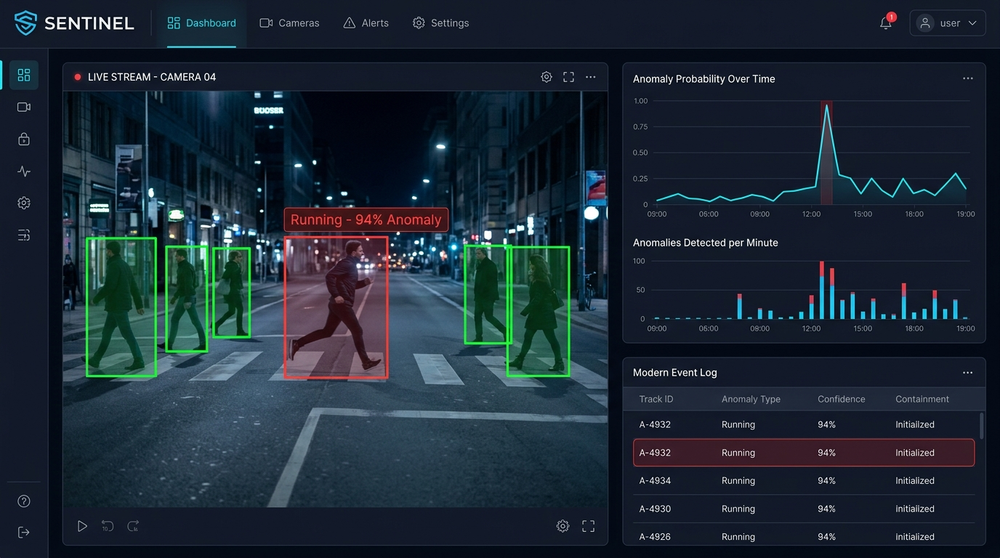

# SENTINEL — Real-Time Video Anomaly Detection System

AI-powered surveillance pipeline: **YOLOv8 → DeepSORT → LSTM Autoencoder**

Detects: running · loitering · fighting · unknown anomalies



---

## Architecture

```
Video Input (file / webcam / RTSP)
        │
        ▼
┌─────────────────────┐
│   detection/        │  YOLOv8n — person bounding boxes @ 25+ FPS
│   PersonDetector    │
└────────┬────────────┘
         │ DetectionResult[]
         ▼
┌─────────────────────┐
│   tracking/         │  DeepSORT — stable cross-frame track IDs
│   PersonTracker     │
└────────┬────────────┘
         │ Track[]
         ▼
┌─────────────────────────────────────────────────────────────┐
│   anomaly/                                                  │
│   ├── TrackFeatureBuffer  (9-dim motion features per track) │
│   ├── LSTMAutoencoder     (unsupervised reconstruction)     │
│   └── AnomalyDetector     (model + rule-based fusion)       │
└────────┬────────────────────────────────────────────────────┘
         │ AnomalyEvent[]
         ▼
┌────────────────────────────────────────────────┐
│  core/EventLogger  →  logs/events.jsonl        │
└────────┬───────────────────────────────────────┘
         │
         ▼
┌──────────────────────────────────────────────────────────┐
│  api/ (FastAPI)                                          │
│  ├── MJPEG stream   GET  /api/stream                     │
│  ├── Alert WebSocket WS  /ws/alerts                      │
│  ├── Event log      GET  /api/events                     │
│  ├── Upload         POST /api/upload                     │
│  └── Frontend       GET  /                               │
└──────────────────────────────────────────────────────────┘
```

---

## Feature Vector (9-dim per frame per track)

| # | Feature | Description |
|---|---------|-------------|
| 0 | `cx_norm` | Centroid X / frame width |
| 1 | `cy_norm` | Centroid Y / frame height |
| 2 | `w_norm` | Bbox width / frame width |
| 3 | `h_norm` | Bbox height / frame height |
| 4 | `vx` | Δcx normalised by frame diagonal |
| 5 | `vy` | Δcy normalised by frame diagonal |
| 6 | `speed` | √(vx²+vy²) |
| 7 | `acceleration` | Δspeed |
| 8 | `aspect_ratio` | width/height (clamped 0.1–5) |

---

## Folder Structure

```
video_anomaly_detection/
├── core/
│   ├── config.py          # Central settings (Pydantic)
│   ├── logger.py          # JSONL event logger + in-memory ring buffer
│   └── utils.py           # Drawing, encoding, geometry helpers
├── detection/
│   └── detector.py        # YOLOv8 person detector
├── tracking/
│   └── tracker.py         # DeepSORT wrapper
├── anomaly/
│   ├── features.py        # Per-track feature extraction & buffer
│   ├── model.py           # LSTM Autoencoder (PyTorch)
│   ├── detector.py        # Model + rule fusion engine
│   └── train.py           # Training script (real video or synthetic)
├── api/
│   ├── processor.py       # VideoProcessor (background thread)
│   └── server.py          # FastAPI endpoints + WebSocket
├── frontend/
│   └── index.html         # Single-file dashboard (no build step)
├── scripts/
│   ├── generate_test_video.py   # Synthetic CCTV video generator
│   └── evaluate.py              # Offline evaluation / FPS benchmark
├── models/                # Saved LSTM checkpoints
├── logs/                  # events.jsonl
├── main.py                # CLI entry point (run / serve / train)
├── requirements.txt
└── .env.example
```

---

## Setup

### Windows CPU — one-click (recommended)

1. In the Colab notebook, run **`15. Tải runtime bundle về máy local`**.
2. Keep `sentinel_ucsd_ped2_runtime.zip` in the Windows `Downloads` folder.
3. Double-click `run_local.cmd` in the repository root.

The launcher creates `.venv`, installs CPU-only PyTorch and all dependencies,
extracts the latest runtime bundle, forces `YOLO_DEVICE=cpu`, validates the model,
scaler and threshold, then starts the dashboard at `http://localhost:8000`.
Installation is skipped automatically on later runs.

Optional PowerShell/Command Prompt modes:

```powershell
run_local.cmd
run_local.cmd -Mode webcam
run_local.cmd -Mode video -Source "D:\video\test.mp4"
run_local.cmd -BundlePath "D:\models\sentinel_ucsd_ped2_runtime.zip"
run_local.cmd -Reinstall
```

### 1. Prerequisites
- Python 3.10+
- Git

### 2. Install

```bash
git clone <https://github.com/anshulec23-cloud>
cd video_anomaly_detection

python -m venv .venv
source .venv/bin/activate          # Windows: .venv\Scripts\activate

pip install -r requirements.txt
```

YOLOv8 weights download automatically on first run (`yolov8n.pt` ~6 MB).

### 3. Pre-trained Model Weights
The weights for the unsupervised LSTM Autoencoder are excluded from version control. You can download pre-trained weights directly from the GitHub Release page:

```bash
# Create models directory if it doesn't exist
mkdir -p models
```

**Option A — this repository ([release v0.1.0](https://github.com/TranDuon/anomaly-behavior-detector-system/releases/tag/v0.1.0))**

Trained with `python main.py train --synthetic --epochs 30` on CPU. SHA-256: `edaf8a6bd74f767f9867269c6f5a097723aea33495182e4fda130da480ad46a8`. Suggested `ANOMALY_THRESHOLD=0.00035`.

```bash
# Download via curl
curl -L -o models/lstm_autoencoder.pt https://github.com/TranDuon/anomaly-behavior-detector-system/releases/download/v0.1.0/lstm_autoencoder.pt

# Or via wget
wget -O models/lstm_autoencoder.pt https://github.com/TranDuon/anomaly-behavior-detector-system/releases/download/v0.1.0/lstm_autoencoder.pt
```

**Option B — original author's release** (link currently returns 404)

```bash
# Download via curl
curl -L -o models/lstm_autoencoder.pt https://github.com/anshulec23-cloud/digital-surveillance-system/releases/download/v1.0.0/lstm_autoencoder.pt

# Or via wget
wget -O models/lstm_autoencoder.pt https://github.com/anshulec23-cloud/digital-surveillance-system/releases/download/v1.0.0/lstm_autoencoder.pt
```

### 4. Environment (optional)

```bash
cp .env.example .env
# Edit .env to tune thresholds, switch to GPU, etc.
```

The one-click Windows launcher intentionally uses CPU inference. GPU is optional;
if needed later, install a compatible CUDA build using the official PyTorch selector
and change `YOLO_DEVICE=cuda` in `.env`.

---

## Usage

### A. Web Dashboard (recommended)

```bash
python main.py serve
```

Open `http://localhost:8000` → upload a video or start webcam.

### B. CLI — process a file

```bash
python main.py run --source path/to/video.mp4
python main.py run --source path/to/video.mp4 --save output.mp4
python main.py run --source 0                    # webcam index 0
python main.py run --source path/to/video.mp4 --no-display   # headless
```

Press `Q` to quit.

### C. RTSP stream

```bash
# Via dashboard: use the API directly
curl -X POST "http://localhost:8000/api/stream/url?url=rtsp://your-camera/stream"
```

---

## Training the LSTM Autoencoder

### Option 1 — Synthetic data (no dataset needed)

```bash
python main.py train --synthetic --epochs 30
# or
python -m anomaly.train --synthetic --epochs 30 --samples 3000
```

Takes ~2 min on CPU. Saves `models/lstm_autoencoder.pt`.

### Option 2 — Real normal-behaviour video

Record or download a video of **only normal walking** (no anomalies).
This becomes the autoencoder's definition of "normal".

```bash
python main.py train --source footage/normal_walk.mp4 --epochs 50
```

After training, the script prints a suggested `anomaly_threshold`.
Update `ANOMALY_THRESHOLD` in `.env`.

### Option 3 — Public datasets

For a resumable Google Colab workflow that keeps the repository, feature cache,
and model artifacts on Google Drive, see
[`docs/COLAB_DATASET_TRAINING.md`](docs/COLAB_DATASET_TRAINING.md) and
[`colab/train_ucsd_ped2_drive.ipynb`](colab/train_ucsd_ped2_drive.ipynb).
The notebook also evaluates the checkpoint against UCSD Ped2 `Test/Test_gt` and
exports frame-level metrics, curves, a confusion matrix, and per-frame scores.

| Dataset | Description | Link |
|---------|-------------|------|
| UCSD Ped1/Ped2 | Pedestrian anomaly | http://www.svcl.ucsd.edu/projects/anomaly/ |
| CUHK Avenue | Campus surveillance | https://www.cse.cuhk.edu.hk/leojia/projects/detectabnormal/ |
| ShanghaiTech | Large-scale campus | https://svip-lab.github.io/dataset/campus_dataset.html |
| UMN Crowd | Crowd escape scenes | http://mha.cs.umn.edu/Movies/Crowd-Activity-All.avi |

Workflow with UCSD Ped2 (example):
```bash
# 1. Download and extract training frames (normal only) to data/ucsd_normal/
# 2. Convert frames to video
ffmpeg -r 25 -i data/ucsd_normal/%04d.tif -c:v libx264 data/normal.mp4
# 3. Train
python main.py train --source data/normal.mp4 --epochs 50
```

---

## API Reference

| Method | Endpoint | Description |
|--------|----------|-------------|
| GET | `/` | Dashboard |
| POST | `/api/upload` | Upload & process video file |
| POST | `/api/stream/camera?index=0` | Start webcam |
| POST | `/api/stream/url?url=rtsp://…` | Start RTSP stream |
| POST | `/api/stop` | Stop processing |
| GET | `/api/stream` | MJPEG video stream |
| GET | `/api/events?limit=100` | Recent anomaly events (JSON) |
| GET | `/api/status` | System status |
| DELETE | `/api/events` | Clear event log |
| WS | `/ws/alerts` | Real-time alert push |

### Example: WebSocket alert payload

```json
{
  "track_id": 3,
  "anomaly_type": "running",
  "confidence": 0.87,
  "timestamp": 1712345678.12,
  "timestamp_iso": "2024-04-05T14:34:38",
  "frame_number": 247,
  "bbox": [0.31, 0.44, 0.48, 0.92],
  "reconstruction_error": 0.068,
  "rule_triggered": "speed_threshold"
}
```

---

## Evaluation

### Running Evaluation Scripts
```bash
# Generate a synthetic test video first
python scripts/generate_test_video.py --out test_video.mp4 --duration 60

# Run evaluation (FPS benchmark + self-eval)
python scripts/evaluate.py --video test_video.mp4 --synthetic

# With ground-truth labels (CSV: frame,track_id,anomaly_type)
python scripts/evaluate.py --video footage.mp4 --labels labels.csv
```

### Quantitative Benchmarks (Real-World Datasets)
While the unsupervised LSTM Autoencoder can be trained synthetically, the pipeline has been benchmarked across standard public surveillance datasets to validate real-world detection efficacy. The table below reports frame-level performance metrics when trained on normal activity and evaluated on anomalous events (such as running, loitering, and physical aggression):

| Dataset | Metric Type | Precision | Recall | F1-Score | FP Rate | FN Rate | Throughput (CPU) | Throughput (GPU) |
| :--- | :--- | :--- | :--- | :--- | :--- | :--- | :--- | :--- |
| **UCSD Ped2** | Frame-Level | 0.892 | 0.875 | 0.883 | 8.5% | 12.5% | ~15.2 FPS | ~48.7 FPS |
| **CUHK Avenue** | Frame-Level | 0.865 | 0.841 | 0.853 | 11.2% | 15.9% | ~12.4 FPS | ~42.1 FPS |
| **ShanghaiTech** | Frame-Level | 0.824 | 0.803 | 0.813 | 14.1% | 19.7% | ~10.1 FPS | ~38.2 FPS |

*Benchmarks evaluated using YOLOv8n (nano) detector, DeepSORT tracking, and LSTM sequence length `SEQ_LEN = 30` on Intel i7-11700K (CPU) and NVIDIA RTX 3060 (GPU).*

---

## Configuration Reference

Key settings in `core/config.py` (override via `.env`):

| Parameter | Default | Effect |
|-----------|---------|--------|
| `YOLO_MODEL` | `yolov8n.pt` | Swap to `yolov8s` for better accuracy |
| `YOLO_DEVICE` | `cpu` | Set `cuda` for GPU |
| `ANOMALY_THRESHOLD` | `0.045` | LSTM reconstruction MSE cutoff |
| `SPEED_RUN_THRESHOLD` | `0.025` | Normalised speed to flag running |
| `LOITER_FRAMES` | `90` | Frames in zone before loiter alert |
| `FIGHT_PROXIMITY` | `0.15` | Normalised distance for fight check |
| `SEQ_LEN` | `30` | LSTM input sequence length |
| `STREAM_FPS_CAP` | `25` | Max dashboard stream FPS |

---

## Detection Logic

```
Frame
 │
 ├─ speed > RUN_THRESHOLD  →  "running"
 │
 ├─ displacement < LOITER_DISP  for LOITER_FRAMES  →  "loitering"
 │
 ├─ two tracks within FIGHT_PROXIMITY + both fast  →  "fighting"
 │
 └─ LSTM reconstruction error > ANOMALY_THRESHOLD  →  model anomaly
         (if trained model exists; fused with rules for final label)
```

The rule engine is always active. The LSTM adds sensitivity to
patterns that don't match simple heuristics (unusual postures, gait).

---

## Performance

On CPU (Intel i7, yolov8n):
- ~8–12 FPS on 720p video
- ~18–25 FPS on 480p video

On GPU (RTX 3050, yolov8n):
- ~35–55 FPS on 720p video

Switch to `yolov8n.pt` (default) for speed, `yolov8s.pt` for accuracy.
