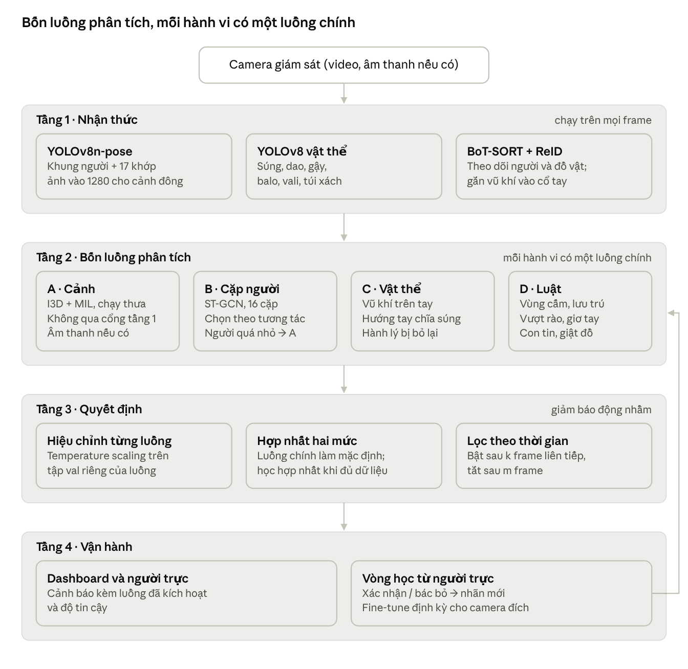

# Báo cáo hướng đi: Phát hiện hành vi tội phạm trong video giám sát

Cập nhật 23/10/2026 · Bản xuất từ báo cáo trên Claude Docs; bản gốc có thể được chỉnh sửa tiếp ở đó.

## 1. Mục tiêu và phạm vi

Đề tài phát hiện hành vi bất thường mang tính tội phạm trong video camera giám sát, cảnh báo theo thời gian thực kèm tên hành vi. Hệ thống tập trung vào 16 hành vi, chia thành 5 nhóm:

1. **Bạo lực và tấn công thể xác:** đánh nhau, tấn công đơn phương, bóp cổ / khóa tay, tấn công bằng hung khí.
2. **Xâm nhập và phá hoại tài sản:** trèo tường / vượt rào, lảng vảng, cạy khóa / phá cửa, đập phá tài sản.
3. **Trộm cắp và cướp giật:** móc túi, cướp giật rồi tẩu thoát, trộm đồ trong cửa hàng.
4. **Đe dọa và sử dụng vũ khí:** rút và chĩa súng, cầm hung khí đe dọa, bắt con tin.
5. **Dấu hiệu đi kèm tội phạm:** bỏ rơi hành lý / đồ vật lạ, nạn nhân giơ tay đầu hàng.

Ngoài phạm vi: sự cố an toàn không do hành vi phạm tội (ngã, tai nạn giao thông, cháy nổ, đám đông hoảng loạn). Không dùng UCSD Ped1/Ped2, ShanghaiTech Campus, CUHK Avenue làm dữ liệu chính, vì bất thường trong các bộ này chủ yếu là xe đạp, ván trượt, đi sai hướng, không phải hành vi tội phạm.

## 2. Hướng đi tổng quan

Kiến trúc chốt gồm 4 tầng và 4 luồng phân tích chạy song song; mỗi hành vi có một luồng chính chịu trách nhiệm, các luồng khác xác nhận. Luồng A xử lý cả khung hình và không phụ thuộc tầng 1, nên bắt được cả hành vi ít chuyển động như cạy khóa, trộm đồ.

Tầng 1 chạy trên mọi frame. Luồng B chỉ chạy trên các cặp người gần nhau hoặc bị gắn cờ, và chuyển sang luồng A khi người quá nhỏ để lấy khung xương. Vòng học từ người trực đưa nhãn mới của camera đích về lại tầng 2.

| Hành vi | Luồng chính | Luồng hỗ trợ |
| --- | --- | --- |
| Đánh nhau | B | A |
| Tấn công đơn phương | B | A |
| Bóp cổ / khóa tay | B (video tự quay) | D: cổ tay sát cổ kéo dài |
| Tấn công bằng hung khí | B | C: vũ khí trên tay |
| Trèo tường / vượt rào | D | B: tư thế trèo |
| Lảng vảng | D | Không |
| Cạy khóa / phá cửa | A | D: đứng lâu sát cửa |
| Đập phá tài sản, phóng hỏa | A | Không |
| Móc túi | B | Không |
| Cướp giật rồi tẩu thoát | B | D: tăng tốc sau tiếp xúc; A |
| Trộm đồ trong cửa hàng | A | A: đầu phụ thao tác tay – kệ (MERL) |
| Rút và chĩa súng | C | B: hướng cánh tay |
| Cầm hung khí đe dọa | C | B: tư thế giơ cao |
| Bắt con tin | D | C + B: vũ khí sát đầu người khác, nạn nhân đứng yên |
| Bỏ rơi hành lý | C | D: khoảng cách người – vật |
| Giơ tay đầu hàng | D | Không |
| Hành vi lạ ngoài danh sách | A: đầu bất thường / bình thường | Không |

Hợp nhất học được chỉ train cho hành vi có dữ liệu chạy được nhiều luồng cùng lúc: đánh nhau (UBI-Fights, Surveillance Camera Fight: A + B), các lớp UCF-Crime có trích khung xương (A + B), và video tự quay (cả bốn luồng). Các hành vi khác dùng luồng chính.

Phía train áp dụng chung cho mọi luồng:

- Loại video trùng giữa các dataset bằng hash ảnh trước khi chia tập.
- Không gian nhãn chung cho 16 hành vi; loss che các lớp mà dataset không gán.
- Mọi khung xương trích lại bằng cùng mô hình YOLOv8-pose dùng khi chạy thật.
- Luồng B có lớp nền; mẫu âm khó lấy từ NTU (ôm, bắt tay) và video Normal của UCF-Crime.
- Chỉ lưu đặc trưng lên Drive; lưu checkpoint mỗi epoch để train tiếp khi Colab bị ngắt.
- Fine-tune trên video của camera đích trước khi demo.

Rủi ro còn lại: chạy đủ bốn luồng trên CPU có thể không đạt real-time. Luồng A lấy mẫu thưa, luồng B chỉ chạy trên cặp nghi vấn, mô hình xuất ONNX / OpenVINO; tốc độ thực tế cần đo.

## 3. Dataset cho từng loại hành động

13/16 hành vi có dữ liệu công khai để train; 3 hành vi (bóp cổ, bắt con tin, giơ tay đầu hàng) không có bộ riêng và phải dùng luật hoặc tự thu thập. "Mức nhãn" quyết định cách train: nhãn cả video chỉ cho phép học giám sát yếu, nhãn theo clip hoặc bounding box cho phép học có giám sát.

| Nhóm | Hành vi | Dataset train | Mức nhãn | Phương pháp |
| --- | --- | --- | --- | --- |
| Bạo lực | Đánh nhau | UBI-Fights (bộ chính); Surveillance Camera Fight; Real Life Violence Situations; UCF-Crime (Fighting) | Frame (UBI-Fights); clip; video | Khung xương + phân loại clip |
| Bạo lực | Tấn công đơn phương | UCF-Crime (Assault, Abuse); XD-Violence (Abuse); NTU RGB+D 120 (knock over other person) | Video khi train, frame khi test | Giám sát yếu + khung xương |
| Bạo lực | Bóp cổ / khóa tay | Không có bộ công khai riêng; tự quay diễn lại, cắt thêm đoạn từ UCF-Crime (Abuse, Assault) | Tự gán nhãn | Khung xương: khoảng cách cổ tay – cổ và thời gian giữ |
| Bạo lực | Tấn công bằng hung khí | NTU RGB+D 120 (wield knife towards other person, hit other person with something); XD-Violence; bộ vũ khí ĐH Granada | Clip; bounding box | Khung xương + phát hiện vũ khí |
| Xâm nhập | Trèo tường / vượt rào | Subway (nhảy qua cổng soát vé); UCF-Crime (Burglary); video tự quay | Frame; video | Luật vùng cấm + trọng tâm cơ thể nâng cao đột ngột |
| Xâm nhập | Lảng vảng | Subway (loitering); video tự quay | Frame | Luật thời gian lưu trú trong vùng, không cần train |
| Xâm nhập | Cạy khóa / phá cửa | UCF-Crime (Burglary) | Video | Giám sát yếu + luật đứng lâu sát cửa |
| Xâm nhập | Đập phá tài sản | UCF-Crime (Vandalism, Arson) | Video | Giám sát yếu |
| Trộm cướp | Móc túi | NTU RGB+D 60/120 (touch other person's pocket), quay dàn dựng trong phòng | Clip | Khung xương |
| Trộm cướp | Cướp giật rồi tẩu thoát | UCF-Crime (Robbery, Stealing); NTU RGB+D 120 (grab other person's stuff) | Video; clip | Khung xương + gia tốc quỹ đạo |
| Trộm cướp | Trộm đồ trong cửa hàng | UCF-Crime (Shoplifting); MERL Shopping (tương tác tay – kệ hàng) | Video; frame | Giám sát yếu + tương tác tay – vật |
| Vũ khí | Rút và chĩa súng | NTU RGB+D 120 (shoot at other person with a gun); UCF-Crime (Shooting); XD-Violence (Shooting); bộ vũ khí ĐH Granada | Clip; video; bounding box | Phát hiện súng + hướng cánh tay |
| Vũ khí | Cầm hung khí đe dọa | Bộ vũ khí ĐH Granada (súng ngắn, dao); lớp knife và baseball bat có sẵn trong COCO | Bounding box | Phát hiện vật thể + tư thế giơ cao |
| Vũ khí | Bắt con tin | Không có bộ công khai | — | Hướng phát triển |
| Đi kèm | Bỏ rơi hành lý / đồ vật lạ | PETS 2006; AVSS 2007 (i-LIDS); ABODA; lớp backpack, handbag, suitcase có sẵn trong COCO | Sự kiện; frame | YOLO + luật khoảng cách người – vật |
| Đi kèm | Giơ tay đầu hàng | Không cần dataset riêng | — | Luật trên khung xương: cổ tay cao hơn đầu liên tục vài giây |

Kinetics-400 (các lớp punching, kicking, slapping…) dùng để pre-train backbone cho các mô hình phân loại clip, không dùng để train trực tiếp hành vi nào.

## 4. Tổng hợp các dataset chính

UCF-Crime và XD-Violence là hai bộ nền cho nhiều lớp tội phạm cùng lúc; các bộ còn lại bổ sung cho từng hành vi cụ thể. Mỗi bộ có metric chuẩn riêng, nên kết quả được báo cáo theo từng bộ thay vì một con số chung.

| Dataset | Quy mô (xấp xỉ) | Nội dung | Mức nhãn | Metric chuẩn |
| --- | --- | --- | --- | --- |
| UCF-Crime | 1.900 video, \~128 giờ | 13 lớp: Abuse, Arrest, Arson, Assault, Burglary, Explosion, Fighting, Road Accident, Robbery, Shooting, Shoplifting, Stealing, Vandalism | Video (train), frame (test) | AUC theo frame |
| XD-Violence | 4.754 video, \~217 giờ, có âm thanh | 6 lớp: Abuse, Car Accident, Explosion, Fighting, Riot, Shooting | Video (train), frame (test) | Average Precision |
| RWF-2000 | 2.000 clip × 5 giây | Fight / Non-Fight từ camera giám sát; hiện không tải được (video đã bị gỡ) | Clip | Accuracy |
| UBI-Fights | 1.000 video (216 đánh nhau), \~80 giờ, 640×360, 30 fps, có tập test chuẩn | Đánh nhau và bình thường | Frame | AUC theo frame |
| Surveillance Camera Fight | 300 clip (150 / 150) | Fight / Non-Fight từ CCTV | Clip | Accuracy |
| NTU RGB+D 120 | \~114.000 mẫu, 120 lớp | Hành động 1 và 2 người, có khung xương 3D, quay trong phòng lab | Clip | Accuracy (cross-subject, cross-setup) |
| Subway | 2 video dài (lối vào, lối ra ga tàu) | Đi ngược chiều, không trả vé, lảng vảng | Sự kiện | Số sự kiện phát hiện đúng / báo nhầm |
| MERL Shopping | 106 video × \~2 phút | 5 hành động tay – kệ hàng trong cửa hàng | Frame | mAP |
| Bộ vũ khí ĐH Granada | Ảnh có bounding box | Súng ngắn, dao và vật cầm tay dễ nhầm | Bounding box | mAP |
| PETS 2006 / AVSS 2007 / ABODA | Vài chục chuỗi video | Bỏ lại hành lý, đồ vật | Sự kiện | Số sự kiện phát hiện đúng / báo nhầm |
| Kinetics-400 | \~300.000 clip, 400 lớp | Hành động người tổng quát (pre-train) | Clip | Top-1 accuracy |

Số liệu lấy từ bài báo gốc (mục 7), cần đối chiếu lại khi tải. NTU RGB+D phải gửi đơn trước khi tải. RWF-2000 hiện không tải được: nhóm tác giả đã gỡ video vì yêu cầu quyền riêng tư và cấm phân phối lại khi chưa được SMIIP Lab đồng ý, nên đề tài dùng UBI-Fights (tải trực tiếp, có tập test chuẩn) làm bộ chính cho hành vi đánh nhau.

## 5. Lộ trình triển khai

Triển khai theo 5 giai đoạn, từ phần không cần train đến phần cần nhiều dữ liệu nhất; mỗi giai đoạn ra một bản chạy được trên dashboard.

1. **Luật và vùng cấm:** thêm công cụ vẽ vùng cấm (ROI) và đường ranh giới trên dashboard; luật lảng vảng, vượt rào. Ngưỡng tính theo giây và theo chiều cao người thay vì theo frame và pixel. Kiểm thử trên Subway và video tự quay.
2. **Phát hiện vật thể:** fine-tune YOLOv8 trên bộ vũ khí ĐH Granada, giữ các lớp COCO có sẵn (người, balo, vali, túi xách, dao). Thêm luật bỏ rơi hành lý; kiểm thử trên PETS 2006 và ABODA.
3. **Nhận dạng hành động từ khung xương:** dùng YOLOv8n-pose (ảnh vào 1280) lấy 17 keypoint mỗi người; train ST-GCN theo cặp người trên khung xương trích từ UBI-Fights, test chéo trên Surveillance Camera Fight (đang thực hiện, xem mục 6); bổ sung NTU RGB+D 120 nếu được cấp quyền. Thêm luật giơ tay đầu hàng.
4. **Phát hiện bất thường giám sát yếu:** train mô hình MIL (ví dụ RTFM) trên đặc trưng I3D đã trích sẵn của UCF-Crime và XD-Violence, cho điểm bất thường và lớp của các hành vi trộm, cướp, phá hoại.
5. **Tích hợp và đánh giá:** hợp nhất kết quả các nhánh, lọc cảnh báo qua k frame liên tiếp. Đo metric trên tập test của từng dataset, đo FPS trên CPU, và chạy thử trên bộ video kịch bản tự quay của nhóm.

## 6. Tiến độ: hành vi đánh nhau (luồng B)

Code luồng B cho hành vi đánh nhau đã hoàn thành và đưa lên repository (commit 24c004a, 23/10/2026). Bước tiếp theo là trích khung xương và train trên Colab Pro với UBI-Fights; kết quả AUC sẽ được cập nhật vào mục này sau khi train.

Pipeline gồm 4 bước, chạy bằng notebook `colab/train_fight_drive.ipynb`:

1. **Loại video trùng** giữa các dataset bằng hash ảnh. Chỉ cặp khác dataset bị loại khỏi train; cặp trong cùng dataset được giữ để không phá tập chia chuẩn của tác giả.
2. **Trích khung xương** bằng YOLOv8n-pose + BoT-SORT, lưu từng video lên Drive, chạy tiếp được khi Colab ngắt; nhiều tiến trình chạy song song trên GPU L4, chỉ trích đoạn cần cho train — đoạn đánh nhau ±10 giây (6,0 → 3,5 giờ) và 20 giây mỗi video bình thường (60,1 → tối đa 4,2 giờ); tập test lấy đủ 40 video đánh nhau và 60 giây đầu mỗi video bình thường (tổng 79 giờ video → khoảng 9,7 giờ).
3. **Train ST-GCN** trên đồ thị 34 khớp của hai người; mỗi cửa sổ là một túi cặp người, điểm cửa sổ là điểm cặp cao nhất (MIL). Checkpoint lưu mỗi epoch, ngưỡng chọn trên tập validation.
4. **Đánh giá** trên tập test rút gọn của UBI-Fights (40 video đánh nhau đầy đủ + 60 giây mỗi video bình thường; AUC theo frame; đề tài không so sánh với bài báo khác), test chéo trên Surveillance Camera Fight (theo clip) và riêng nhóm video đông người; chấm một cửa sổ mỗi 0,3 giây, frame ở giữa được nội suy.

Các lựa chọn cấu hình đều dựa trên số đo thật (CPU máy local; 4 video UBI-Fights lấy trong đoạn đánh nhau):

| Thành phần | Lựa chọn | Lý do (số đo) |
| --- | --- | --- |
| Model pose | YOLOv8n-pose, ảnh vào 1280 | Cảnh đông UMN: 9,6 người/frame so với 2,6 ở ảnh 640; gần bằng bản s ở 1280 (10,4) nhưng nhanh gấp \~4 lần (106 so với 412 ms/frame) |
| Lấy mẫu | 10 FPS, cửa sổ 24 mẫu (2,4 giây) | Trích pose có tracking đạt \~7,5 mẫu/giây trên CPU |
| Tracker | BoT-SORT có ReID | Giữ ID qua che khuất ngắn trong cửa sổ |
| Chọn cặp | Tối đa 16 cặp trong 1,5 lần chiều cao người, xếp theo mức tương tác | Cảnh đánh nhau có 13–130 cặp ứng viên/cửa sổ; ST-GCN chấm 16 cặp mất \~87 ms, 32 cặp \~230 ms |
| Dữ liệu | UBI-Fights (train + test rút gọn); Surveillance Camera Fight (test chéo) | RWF-2000 đã bị gỡ; UBI-Fights có nhãn theo frame và 5–19 người/frame trong cảnh đánh nhau |

Kiểm chứng hiện có: 22 test tự động; chạy thử toàn bộ pipeline trên dữ liệu giả; 225/229 cửa sổ đánh nhau trong 4 video UBI-Fights có ít nhất một cặp ứng viên. Hạn chế đã biết: trên cảnh quán bar rất đông, cặp được xếp hạng cao nhất không trùng nhóm đang xô xát khi kiểm tra bằng mắt; AUC của nhóm đông người sẽ kiểm chứng model có bù được không.

**Kết quả lần train 1 (23/10/2026, GPU L4, khoảng 3 giờ gồm 1 giờ 50 phút tải dataset lần đầu, 47 phút trích khung xương, 23 phút train): model còn yếu.**

| Đánh giá | AUC |
| --- | --- |
| UBI-Fights, theo frame (tập test rút gọn) | 0,61 |
| UBI-Fights, nhóm đông người (≥ 5 người/frame), theo frame | 0,50 |
| Surveillance Camera Fight, theo clip (test chéo) | 0,72 |

Loss train chỉ giảm từ 0,72 xuống 0,61 (đoán ngẫu nhiên là 0,69), AUC validation cao nhất 0,66 ở epoch 2. AUC theo video của UBI-Fights (0,94) không dùng vì bị thổi phồng do video đánh nhau dài hơn video bình thường. Đã sửa trước lần train 2: các ô đệm toàn số 0 trong túi cặp người không còn đi qua BatchNorm (làm việc học chậm và lệch giữa train và đánh giá), ngưỡng chọn theo balanced accuracy thay vì F1 (ngưỡng cũ báo nhầm 75% frame bình thường), thêm bước chẩn đoán (độ phủ cặp người, đường cơ sở thủ công, thử overfit). Nếu sau lần 2 luồng B vẫn yếu, làm luồng A (đặc trưng hình ảnh) cho đánh nhau rồi hợp nhất A + B.

**Kết quả lần train 2 (24/10/2026): sửa lỗi có tác dụng với việc học nhưng chưa cải thiện kết quả test.**

| Đánh giá | Lần 1 | Lần 2 |
| --- | --- | --- |
| UBI-Fights, theo frame (tập test rút gọn) | 0,61 | 0,61 |
| UBI-Fights, nhóm đông người, theo frame | 0,50 | 0,52 |
| Surveillance Camera Fight, theo clip | 0,72 | 0,72 |

Thử overfit đạt AUC 1,00 và loss train giảm đều (0,69 → 0,56), nên pipeline học được; nhưng val loss tăng từ epoch 4 (overfit), AUC validation cao nhất 0,67. Ở ngưỡng đã chọn, model báo nhầm 47% frame bình thường (nhóm đông người: 77%). Phân tích theo video cho thấy ba nguyên nhân: (1) trong từng video đánh nhau, model không phân biệt đoạn đánh với đoạn yên (AUC trung vị 0,52), khoảng 69% frame bình thường của tập test nằm trong chính các video này; (2) điểm tăng theo số người trong cảnh, vì điểm cửa sổ là max của các cặp; (3) điểm tương tác tự tính chỉ đạt AUC 0,59, tín hiệu khung xương yếu.

Lần 3 bỏ các quyết định cắt dữ liệu để tiết kiệm tài nguyên Colab của lần 1–2: trích khung xương toàn bộ video (~79 giờ thay vì ~9,7 giờ), validation và chọn ngưỡng trên video đầy đủ theo frame, đánh giá trên toàn bộ tập test. Ngoài ra: lấy mẫu cân bằng giữa cảnh bình thường trong video đánh nhau và video bình thường, hard-negative mining, bỏ cửa sổ sát ranh giới nhãn, gộp điểm các cặp bằng smooth max chuẩn hóa theo số cặp, thêm RLVS vào train. Pose model, 10 FPS, cửa sổ và số cặp giữ nguyên vì phải khớp với máy chạy thật chỉ có CPU.

- [ ] Chạy notebook trên Colab Pro (GPU L4): trích khung xương, train, đánh giá
- [ ] Cập nhật AUC (UBI-Fights, nhóm đông người) và accuracy (Surveillance Camera Fight) vào mục này
- [ ] Tích hợp model vào dashboard, thay luật `fighting` cũ, khoanh cặp người bị nghi
- [ ] Luồng A (I3D + MIL) cho đánh nhau, rồi hợp nhất A + B

## 7. Khó khăn gặp phải và hướng xử lý

Khó khăn lớn nhất là dữ liệu: nhiều hành vi không có bộ công khai, và bộ có sẵn thường khác xa camera thật. Bảng dưới xếp theo mức ảnh hưởng.

| Khó khăn | Biểu hiện | Hướng xử lý |
| --- | --- | --- |
| Thiếu dữ liệu cho hành vi hiếm | Bóp cổ, móc túi, cạy khóa, bắt con tin gần như không có video CCTV có nhãn | Dùng dữ liệu dàn dựng (NTU RGB+D); nhóm tự quay kịch bản có sự đồng ý của người tham gia; ưu tiên hành vi có dữ liệu, đưa phần còn lại vào hướng phát triển |
| Khác biệt giữa dữ liệu train và camera thật | NTU quay trong phòng lab, XD-Violence có cảnh phim; góc quay, độ phân giải, ánh sáng khác CCTV | Dùng đặc trưng khung xương, ít phụ thuộc bối cảnh hơn ảnh gốc; fine-tune thêm trên một tập nhỏ CCTV thật; tăng cường dữ liệu (độ sáng, làm mờ, giảm độ phân giải) |
| Nhãn thô | UCF-Crime và XD-Violence chỉ có nhãn cả video khi train, không biết sự kiện xảy ra ở đoạn nào | Học giám sát yếu (Multiple Instance Learning): chia video thành đoạn, mô hình tự tìm đoạn có điểm bất thường cao nhất |
| Mất cân bằng nhãn | Frame bình thường chiếm đa số; accuracy cao mà vẫn bỏ sót sự kiện | Focal loss hoặc lấy mẫu cân bằng khi train; báo cáo AUC, AP, recall theo từng lớp thay vì chỉ accuracy |
| Báo động nhầm | Ôm nhau, đùa giỡn, chơi thể thao giống đánh nhau; chạy đuổi xe buýt giống tẩu thoát; điện thoại bị nhận nhầm là súng | Train với mẫu âm khó (hugging, high-five của NTU, video bình thường của UBI-Fights và UCF-Crime); chỉ cảnh báo khi tín hiệu kéo dài k frame; kết hợp nhiều tín hiệu (vũ khí + hướng tay); người trực xác nhận trước khi xử lý |
| Vũ khí nhỏ và bị che khuất | Dao, súng ngắn chỉ vài chục pixel trong khung hình CCTV, thường bị tay hoặc cơ thể che | Tăng kích thước ảnh đầu vào hoặc cắt ảnh thành ô nhỏ quanh vùng tay; fine-tune trên dữ liệu vật nhỏ; xác nhận bằng tư thế cánh tay |
| Che khuất và đám đông | Người bị che, tracker đổi ID giữa chừng làm đứt chuỗi chuyển động; khung xương thiếu khớp; ở ảnh vào 640, model pose bỏ sót phần lớn người cao dưới \~100 px (cảnh đông UMN: chỉ 2,6 người/frame) | Đã xử lý: ảnh vào 1280 (UMN: 9,6 người/frame), chọn 16 cặp theo mức tương tác, BoT-SORT có ReID; nội suy keypoint bị thiếu; làm mượt điểm số theo thời gian trên từng track |
| Hành vi ít chuyển động bị bỏ sót | Móc túi, cạy khóa không tạo tín hiệu rõ ở tầng 1, nên tầng 2 không được kích hoạt | Trong vùng nhạy cảm (cửa ra vào, quầy hàng) chạy tầng 2 liên tục hoặc theo chu kỳ; kích hoạt khi hai người ở rất gần nhau |
| Phụ thuộc vào từng camera | Ngưỡng tính theo pixel/frame thay đổi khi đổi góc quay, độ phân giải, FPS | Chuẩn hóa theo chiều cao người và theo giây; hiệu chỉnh vùng cấm và ngưỡng riêng cho từng camera khi lắp đặt |
| Tài nguyên tính toán | Máy chạy local chỉ có CPU; pose và mô hình video chạy chậm (đo được: YOLOv8n-pose ảnh 1280 \~106 ms/frame, ST-GCN 16 cặp \~87 ms/cửa sổ) | Luồng B chỉ chạy trên cặp nghi vấn, luồng A lấy mẫu thưa; dùng bản nano của YOLO; bỏ bớt frame; xuất ONNX / OpenVINO; train trên Google Colab L4; đã áp dụng: dựng cửa sổ dạng ma trận (cảnh đông 79 → 18 ms/cửa sổ), trích khung xương song song, chỉ trích đoạn cần cho train và tập test rút gọn (79 → \~9,7 giờ video), FP16, đánh giá bước 0,3 giây |
| Truy cập và dung lượng dữ liệu | NTU phải xin phép; RWF-2000 đã gỡ video; UCF-Crime nặng hàng chục GB; nhiều video Kinetics đã bị gỡ khỏi YouTube | Gửi đơn sớm; dùng đặc trưng I3D đã trích sẵn do cộng đồng chia sẻ; dùng mô hình đã pre-train trên Kinetics thay vì tự tải lại |
| Quyền riêng tư và đạo đức | Dữ liệu chứa hình ảnh người thật; nguy cơ gán nhãn sai người vô tội | Chỉ dùng cho nghiên cứu theo giấy phép dataset; không nhận diện khuôn mặt; làm mờ mặt trong demo; cảnh báo chỉ là gợi ý, người trực quyết định |
| Không có benchmark chung | Mỗi dataset một metric, không so sánh được toàn hệ thống bằng một con số | Báo cáo theo từng hành vi trên dataset tương ứng; thêm một bộ video kịch bản tự quay để đánh giá toàn hệ thống |

## 8. Tài liệu tham khảo

Danh mục tổng hợp theo trí nhớ, cần kiểm tra lại tên và năm trước khi nộp.

**Dataset**

1. Sultani, Chen, Shah. Real-world Anomaly Detection in Surveillance Videos. CVPR 2018. (UCF-Crime)
2. Wu et al. Not only Look, but also Listen: Learning Multimodal Violence Detection under Weak Supervision. ECCV 2020. (XD-Violence)
3. Cheng, Cai, Li. RWF-2000: An Open Large Scale Video Database for Violence Detection. ICPR 2020.
4. Degardin, Proença. Human Activity Analysis: Iterative Weak/Self-Supervised Learning Frameworks for Detecting Abnormal Events. IJCB 2020. (UBI-Fights)
5. Aktı, Tataroğlu, Ekenel. Vision-based Fight Detection from Surveillance Cameras. IPTA 2019. (Surveillance Camera Fight)
6. Shahroudy et al. NTU RGB+D: A Large Scale Dataset for 3D Human Activity Analysis. CVPR 2016.
7. Liu et al. NTU RGB+D 120: A Large-Scale Benchmark for 3D Human Activity Understanding. TPAMI 2020.
8. Adam, Rivlin, Shimshoni, Reinitz. Robust Real-Time Unusual Event Detection Using Multiple Fixed-Location Monitors. TPAMI 2008. (Subway)
9. Singh et al. A Multi-Stream Bi-Directional Recurrent Neural Network for Fine-Grained Action Detection. CVPR 2016. (MERL Shopping)
10. Olmos, Tabik, Herrera. Automatic Handgun Detection Alarm in Videos Using Deep Learning. Neurocomputing 2018. (bộ vũ khí ĐH Granada)
11. PETS 2006 Benchmark Data; AVSS 2007 (i-LIDS). (bỏ rơi hành lý)
12. Lin et al. Abandoned Object Detection via Temporal Consistency Modeling and Back-Tracing Verification. IEEE TIFS 2015. (ABODA)
13. Kay et al. The Kinetics Human Action Video Dataset. arXiv 2017.

**Phương pháp**

14. Carreira, Zisserman. Quo Vadis, Action Recognition? A New Model and the Kinetics Dataset. CVPR 2017. (I3D)
15. Yan, Xiong, Lin. Spatial Temporal Graph Convolutional Networks for Skeleton-Based Action Recognition. AAAI 2018. (ST-GCN)
16. Tian et al. Weakly-supervised Video Anomaly Detection with Robust Temporal Feature Magnitude Learning. ICCV 2021. (RTFM)

17. Aharon, Orfaig, Bobrovsky. BoT-SORT: Robust Associations Multi-Pedestrian Tracking. arXiv 2022. (tracker)
18. Jocher et al. Ultralytics YOLOv8. 2023. (YOLOv8-pose)
