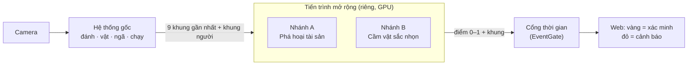
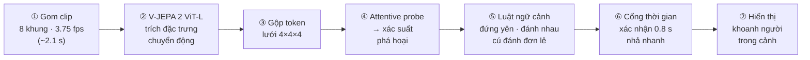
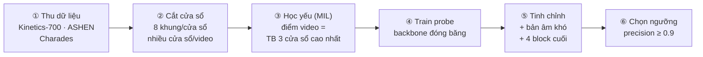
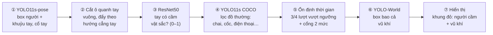
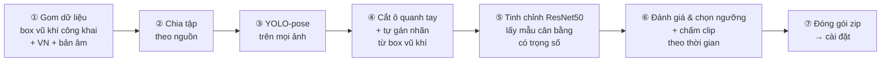
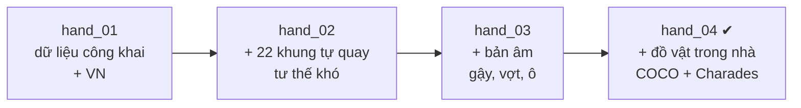

# Hai nhánh mở rộng: Phá hoại tài sản & Người cầm vật sắc nhọn

Tài liệu trình bày theo **pipeline**: mỗi bước dùng **công cụ gì**, nhận **đầu vào** gì, cho ra **đầu ra** gì và **vì sao** chọn như vậy.
Phạm vi: demo trong một phòng, camera laptop / điện thoại.

---

## 0. Bức tranh chung

- Hai nhánh chạy trong **tiến trình riêng** (`extensions/worker.py`, môi trường `extensions/env`): nhánh mở rộng lỗi hay chậm
  thì bỏ lượt, **không làm hỏng** hệ thống gốc.
- Mỗi nhánh trả **một điểm 0–1** mỗi lượt. Cảnh báo không bật từ một khung đơn lẻ mà qua **cổng thời gian**:
  điểm ≥ ngưỡng → *đang xác minh* (vàng) → giữ đủ `confirm_seconds` → *cảnh báo* (đỏ) → điểm dưới ngưỡng tắt đủ
  `release_seconds` → tắt.
- Cách dùng: web `http://localhost:8000` → chọn **"Sáu hành vi: Đánh / Vật / Ngã / Chạy / Phá hoại / Cầm vật sắc"**.

---

## 1. Nhánh A — Phá hoại tài sản

### 1.1 Pipeline nhận diện

| Bước | Công cụ | Đầu vào → Đầu ra | Thông số | Vì sao |
|---|---|---|---|---|
| ① Gom clip | Bộ đệm khung của hệ thống gốc | luồng camera → 8 khung | 3.75 khung/giây, cả khung resize 256×256, không cắt | Phá hoại là **hành động theo thời gian** (đá, đập, xô đổ), một ảnh đơn không đủ |
| ② Trích đặc trưng | **V-JEPA 2 ViT-L** (Meta, tự giám sát trên video, ghim revision) | 8 khung → token không-thời gian | fp16 trên GPU; **4 block cuối được tinh chỉnh** | Model video học sẵn cách vật thể chuyển động / va chạm → cần ít dữ liệu gán nhãn |
| ③ Gộp token | Average pooling | token → lưới 4×4×4 | 64 token đại diện | Giảm chi phí cho bước phân loại |
| ④ Phân loại | **Attentive probe** (width 1024, 16 head, 4 query, hidden 512) | 64 token → xác suất | ngưỡng **0.667** (chọn để precision ≥ 0.9 trên dev) | Query học được tự "nhìn" vào vùng có hành động |
| ⑤ Luật ngữ cảnh | Thông tin từ hệ thống gốc | xác suất → bằng chứng | người đứng yên (chuyển động < 4.0) → 0; cú đánh đơn lẻ ×0.7; đang đánh nhau cần ≥ 0.9 | Tránh nhầm với đứng yên, đánh nhau |
| ⑥ Cổng thời gian | EventGate | bằng chứng → trạng thái | xác nhận 0.8 s, nhả 1.0 s; trung bình 4 lượt dưới ngưỡng → nhả ngay | Chống báo thoáng qua, tắt nhanh khi hết hành vi |
| ⑦ Hiển thị | Khung người của hệ thống gốc | → khung đỏ | khoanh mọi người trong cảnh | Model chấm **cả cảnh**, không biết ai phá |

Tần suất: ~**0.8 s/lần** (model nặng, chạy cách lượt để không làm chậm hệ thống gốc).

### 1.2 Pipeline huấn luyện

| Bước | Nội dung |
|---|---|
| ① Dữ liệu | **Bản dương:** Kinetics-700 *smashing*, *breaking glass*; ASHEN lớp *Vandalism* (đá, xô đổ đồ thật). **Bản âm khó:** đấm bao cát, đá bóng, đóng/mở cửa, quét nhà, lau nhà, khuân đồ, gấp quần áo, đấm người, tát, vật nhau; Charades (cầm / ném đồ trong nhà). Tổng **11 816** mẫu; chia tập **theo nguồn** để một video không lọt cả train lẫn test. Loại: graffiti/phun sơn, tantrum, búa tạ |
| ②–③ Học yếu | Video chỉ có nhãn cả video → chia nhiều cửa sổ; điểm video = **trung bình 3 cửa sổ cao nhất** (Multiple Instance Learning) |
| ④ Probe | Backbone đóng băng, chỉ train probe (probe_01) |
| ⑤ Tinh chỉnh | probe_02: thêm bản âm khó, mở **4 block cuối** (lr 2e-5, layer decay 0.75; probe lr 1e-4), dừng ở epoch 8 |
| ⑥ Ngưỡng | Ngưỡng thấp nhất đạt precision ≥ 0.9 trên dev → **0.667** |

### 1.3 Kết quả (`vjepa2_probe_02_ft`)

| Tập | AP | ROC-AUC | Ở ngưỡng |
|---|---|---|---|
| Dev – toàn bộ (1525) | 0.898 | 0.978 | |
| Dev – Charades (393 bản âm trong nhà) | – | – | **báo nhầm 0%** |
| Test – toàn bộ (1444) | 0.709 | 0.959 | |
| Test – Kinetics | 0.691 | 0.941 | precision 0.74 · recall 0.65 |
| Test – ASHEN (phá hoại thật) | 0.892 | 0.928 | precision 0.65 · recall **0.94** |

Báo nhầm trên dev theo lớp: chặt củi 5.6%, lau nhà 5.9%, đập ván 3.1%, các lớp còn lại 0%.

---

## 2. Nhánh B — Người cầm vật sắc nhọn

### 2.1 Pipeline nhận diện

| Bước | Công cụ | Đầu vào → Đầu ra | Thông số | Vì sao |
|---|---|---|---|---|
| ① Tìm người & tay | **YOLO11s-pose** (17 điểm COCO) | khung hình → box người + khuỷu tay (7, 8), cổ tay (9, 10) | ảnh 640 px, conf 0.35, tối đa 8 người, điểm cổ tay ≥ 0.3 | Vũ khí nguy hiểm khi **đang được cầm** → xét đúng chỗ bàn tay; dao trên bàn không báo |
| ② Cắt ô quanh tay | Hình học (`hand_crop.py`, dùng chung train & runtime) | điểm khớp → ô vuông | cạnh = **0.45 × chiều cao người** (≥ 48 px); tâm = cổ tay + **0.5 × (cổ tay − khuỷu)** | Ô lấy được cán và lưỡi; dao nhỏ (vài chục px) được **phóng to** lên 224 px |
| ③ Phân loại ô | **ResNet50** (ImageNet → tinh chỉnh), 1 logit | ô 224 px → điểm 0–1 | ngưỡng **0.854** (tự chọn: báo nhầm ≤ 3% trên ảnh không vũ khí của val) | Bài toán nhỏ, rõ ràng: "tay này có cầm vật sắc không" |
| ④ Lọc đồ vật thường | **YOLO11s (COCO)**, chỉ chạy khi ③ vượt ngưỡng | ô quanh tay ×2 → có/không đồ thường | chai, cốc, điện thoại, điều khiển, sách, ly, bàn chải, máy sấy, chuột, bình hoa; conf ≥ 0.35, ≥ 60% vật nằm trong ô tay; **không bao giờ** lọc dao/kéo/nĩa | Vật kim loại thon dài (bình inox) dễ giống lưỡi dao; detector COCO nhận các vật này rất chắc |
| ⑤ Ổn định thời gian | Luật k-of-n + EventGate | điểm theo lượt → trạng thái | **≥ 3/4 lượt** gần nhất vượt ngưỡng; xác nhận 0.5 s; ngưỡng tắt **0.5×** ngưỡng, giữ 1.2 s | Vật thường cho điểm nhảy 0.01 ↔ 0.98; dao thật cho điểm cao ổn định |
| ⑥ Box vũ khí | **YOLO-World** (từ vựng mở: knife, machete, sword, spear, axe, sickle, cleaver, long blade on a pole) | vùng 4× ô tay → box vũ khí | conf 0.01 (chỉ để vẽ); gộp box chạm tay; giới hạn ≤ 3× cạnh ô tay | ResNet chỉ trả lời có/không → cần thêm bước định vị để khung bao cả dao |
| ⑦ Hiển thị | Server vẽ khung | → khung đỏ | khung người cầm (khớp khung hệ thống theo IoU ≥ 0.5) + khung vũ khí; giữ khung ≤ 1 s khi một lượt trống, làm mượt 60/40 | Khung không chập chờn, bám người |

Tần suất: **mỗi 0.27 s** (cùng nhịp hệ thống gốc). Chi phí: ~55 ms/lượt (①–③, ⑥), bước ④ thêm ~15 ms chỉ khi có cảnh báo; 0.2 GB VRAM.

### 2.2 Pipeline huấn luyện

| Bước | Nội dung |
|---|---|
| ① Dữ liệu | **Bản dương** (box vũ khí có sẵn): Zenodo, Granada knife, OpenImages (Knife, Dagger, Sword, Axe), COCO knife, Simuletic; bộ VN đã duyệt (dao phóng lợn, mã tấu, kiếm…) gồm **22 khung tự quay** ở tư thế khó. **Bản âm khó:** COCO người cầm gậy/vợt/ô (3000 ảnh); COCO người cầm điện thoại/chai/cốc/sách… (3000, bỏ ảnh có dao/kéo/nĩa); **Charades** — 2324 khung trong nhà, camera nghiệp dư, người cầm chổi/máy hút bụi/điện thoại/cốc (bỏ video nấu ăn) |
| ② Chia tập | Theo nhóm nguồn (cùng video/bài báo không lọt hai tập); 22 khung tự quay **luôn ở train** |
| ③ Pose | YOLO11s-pose ở 960 px (lớn hơn runtime để bắt người nhỏ) |
| ④ Tự gán nhãn | Ô chạm ≥ 25% box vũ khí → **dương**; không chạm → **âm**; lưng chừng → bỏ. Ảnh cận cảnh không thấy người: cắt ô "giả" quanh box vũ khí (chỉ ở train, trọng số ×0.5). **Không cần vẽ box tay** |
| ⑤ Train | ResNet50, AdamW (backbone 1e-4 / đầu ra ×10; tinh chỉnh tiếp 3e-5), cosine, AMP; tăng cường crop/lật/xoay ±20°/màu/mờ; lấy mẫu cân bằng 2 lớp, ảnh VN ×3, bản âm khó ×3; dừng sớm theo AP |
| ⑥ Đánh giá | AP/AUC trên ô tay **thật** của val/test; ngưỡng = thấp nhất mà báo nhầm ≤ 3% trên ảnh không vũ khí của val; chấm **16 clip dao phóng lợn** và **24 clip Charades test** theo thời gian (tỉ lệ bước cảnh báo, số lần tụt điểm) |
| ⑦ Đóng gói | zip: classifier (fp16) + model pose + spec + `evaluation.json`; `install_sharp_object.py` kiểm tra, ghi SHA-256, giữ bản trước |

Chạy trên **Google Colab (L4)**, mã nguồn ghim theo commit, dữ liệu cache trên Drive, phiên tự ngắt khi xong.

### 2.3 Quá trình cải tiến (mỗi bản train tiếp từ bản trước)

| Chỉ số | hand_01 | hand_02 | hand_03 | hand_04 |
|---|---|---|---|---|
| Bắt đúng / báo nhầm theo ảnh (test công khai) | 93% / 3.8% | 91% / 0% | 92% / 0.4% | 92% / 1.7% |
| 16 clip dao phóng lợn: tỉ lệ bước cảnh báo | 76% | 87% | 84% | **89%** |
| 16 clip đó: số lần tụt điểm | 96 | 66 | 82 | **62** |
| Video phá hoại cầm gậy: bước báo nhầm | – | 35% | 12% | **3%** |
| 24 clip Charades test (cầm đồ trong nhà): bước báo nhầm | – | – | 5.4% | **0.9%** |
| Ngưỡng tự chọn | 0.95 | 0.95 | 0.95 | **0.854** |

Thêm bước ④ (lọc COCO) ở runtime: bỏ **15/23** khung báo nhầm bình nước/điện thoại, chỉ mất **5/229** khung dao phóng lợn
(cả 16 clip vẫn được cảnh báo).

---

## 3. Vấn đề gặp khi test thật → bước pipeline xử lý

| Hiện tượng | Nguyên nhân (đã kiểm chứng bằng log) | Xử lý ở bước |
|---|---|---|
| Cài rồi không bao giờ báo | Runtime chỉ bật nhánh khi có file detector cũ | Nhận nhánh qua file spec |
| Khung chỉ bao bàn tay | ResNet chỉ trả lời có/không | B⑥ YOLO-World |
| Khung người xanh khi đang cảnh báo | So khung từng pixel, khung lượt trước lệch vài px | B⑦ khớp theo IoU ≥ 0.5 |
| Khung chập chờn đỏ/xanh | Điểm tụt thoáng qua, khung sống 1 lượt | B⑤ ngưỡng tắt 2 mức; B⑦ giữ khung ≤ 1 s, làm mượt |
| Hình giật, khung nhảy cóc | Nhánh chỉ chạy 0.8 s/lần; hình gửi web không đều | Chạy nhánh B mỗi 0.27 s; web đều 20 khung/giây |
| Cầm gậy bị báo vũ khí | Thiếu bản âm gậy | Train hand_03 |
| Cầm điện thoại, chổi bị báo | Thiếu bản âm đồ trong nhà; 22 khung tự quay toàn bản dương → model học "phòng này + giơ tay = dao" | Train hand_04 (hạ trọng số ×6 → ×3) |
| Bình nước inox bị báo | Kim loại thon dài giống lưỡi; điểm nhảy giữa các khung | B④ lọc COCO + B⑤ luật 3/4 |

Thử nghiệm đã **loại bỏ** (có số đo):
- Lọc bằng YOLO-World "giống gậy hay giống dao" → chặn mất **30/40** cảnh báo dao phóng lợn thật (dao phóng lợn là cây sào có lưỡi).
- Nâng ngưỡng lên 0.997 → điện thoại cũng ≥ 0.95, mất luôn cảnh báo dao thật.

---

## 4. Hiệu năng (RTX 4050 Laptop 6 GB)

| Hạng mục | Số đo |
|---|---|
| Nhánh B mỗi lượt | ~55 ms (pose 17 ms), +15 ms lọc COCO khi có cảnh báo |
| Cập nhật khung vũ khí | 0.80 s → **0.27 s** |
| Nhánh gốc / nhánh A | giữ nguyên 0.27 s / 0.80 s |
| Lượt chấm bị bỏ do quá tải (video 180 s) | 14 → **0** |
| Bộ test có sẵn (runtime, cách ly, server) | 68 đạt, 1 bỏ qua |

---

## 5. Lệnh sử dụng

| Việc | Lệnh / nơi |
|---|---|
| Train | `colab/sharp_object_hand_v4.ipynb` (GPU L4, Run all) |
| Cài nhánh B | `extensions\env\Scripts\python.exe -m extensions.sharp_object.install_sharp_object sharp_object_hand_04.zip` |
| Cài nhánh A | `extensions\env\Scripts\python.exe -m extensions.vandalism.install_vandalism <zip>` |
| Quay lại bản trước | `weights\extensions\sharp_object.previous` |
| Thêm bản âm tự quay | `python -m extensions.sharp_object.make_negative_set <video> --out vn_negatives_001.zip` → Drive `SENTINEL/datasets/sharp_object_vn/` |
| Chấm clip theo thời gian | `python -m extensions.sharp_object.eval_hand_clips --package <thư mục cài> --clips <thư mục> --out kq.json` |
| Clip test có sẵn | `samples\demo video\sharp_test\` |

---

## 6. Giới hạn còn lại

| Giới hạn | Hướng tiếp |
|---|---|
| **Rìu** gần như không bắt được | Thêm Kinetics *chopping wood* làm bản dương |
| **Cây lau nhà giơ cao** còn bị báo ở 1 clip; COCO không có chổi để lọc ở B④ | Bản âm tự quay trong phòng demo; Kinetics *mopping / sweeping floor* |
| Súng, gậy cùn | Ngoài phạm vi dữ liệu |
| Người xa / nhỏ, tay bị che | Pose không thấy cổ tay → không có ô để chấm; đặt camera gần |
| Nhánh A chấm cả cảnh, không biết ai phá | Khoanh người cử động nhiều nhất |
| A và B cùng màu đỏ | Màu và nhãn riêng từng hành vi |
| Test VN nhỏ; dữ liệu báo chí VN chưa xác minh quyền | Quay video kiểm tra độc lập; chỉ dùng nội bộ |

---

## 7. Tóm tắt

- **Nhánh A — Phá hoại:** *gom 2 giây video → V-JEPA 2 trích chuyển động → attentive probe chấm điểm → luật ngữ cảnh
  → cổng thời gian.* Precision ≥ 0.9 trên dev, recall 0.94 trên phá hoại thật (ASHEN), 0% báo nhầm trên Charades.
- **Nhánh B — Vật sắc nhọn:** *YOLO-pose tìm người & bàn tay → cắt ô quanh tay → ResNet50 phán đoán → YOLO COCO lọc đồ
  thường → ổn định 3/4 lượt → YOLO-World vẽ box vũ khí.* Cảnh báo 89% thời gian trên clip dao phóng lợn, báo nhầm 0.9%
  trên clip người cầm đồ trong nhà.
