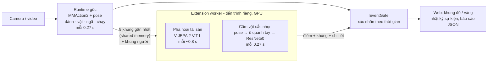
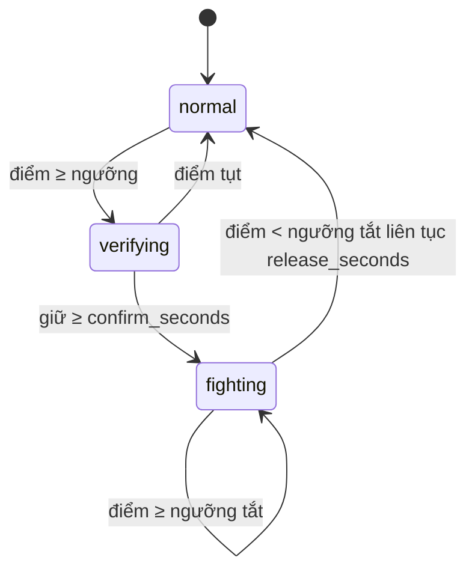
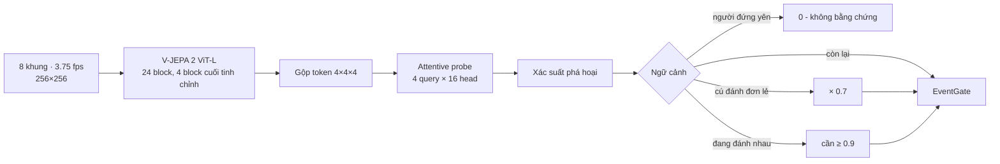
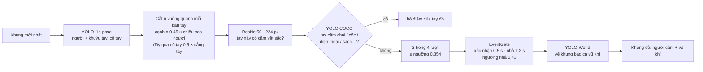
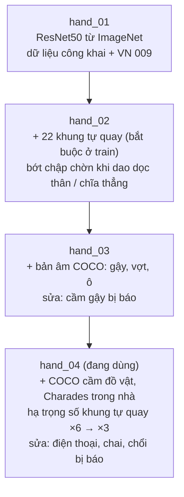
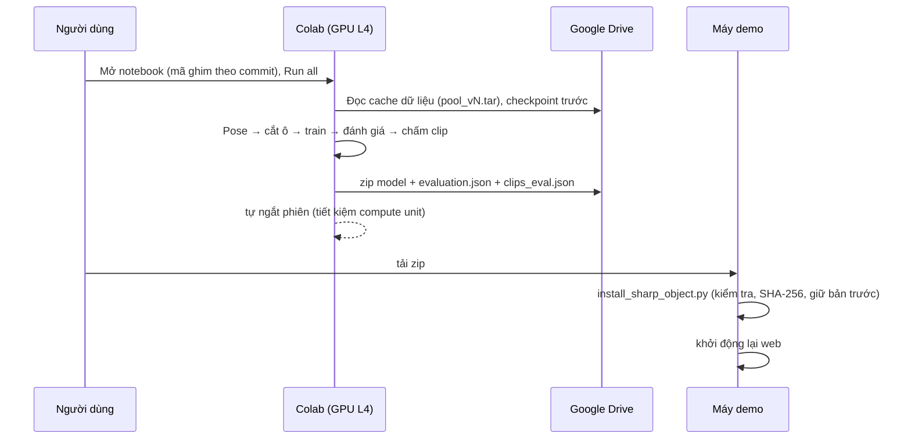

# Hai nhánh mở rộng: Phá hoại tài sản & Người cầm vật sắc nhọn

Tài liệu trình bày: các nhánh này **dùng gì**, **chạy thế nào**, **xử lý các vấn đề ra sao** và **số liệu** chứng minh.
Phạm vi: demo trong một phòng, camera laptop / điện thoại (không nhắm tới CCTV ngoài trời).

---

## 1. Tổng quan kiến trúc

Hệ thống gốc (FightWatch) nhận diện đánh / vật / ngã / chạy. Hai hành vi mới được thêm như **nhánh mở rộng (extension)**:
chạy trong **một tiến trình riêng** (`extensions/worker.py`, môi trường Python riêng `extensions/env`), nhận khung hình
qua bộ nhớ dùng chung, trả điểm về runtime. Nhánh mở rộng lỗi hay chậm **không làm hỏng** nhánh gốc.

| Thành phần | Vai trò |
|---|---|
| `fight/mmaction_runtime.py` | Gửi khung cho worker, đọc kết quả, cổng thời gian (EventGate), giữ / làm mượt khung hiển thị |
| `fight/extension_client.py` | Giao tiếp với worker (không bao giờ chặn nhánh gốc; worker bận thì bỏ lượt) |
| `extensions/worker.py` | Nạp các nhánh đã cài, chạy `observe()` mỗi lượt |
| `extensions/vandalism/` | Nhánh phá hoại (train, cài đặt, runtime) |
| `extensions/sharp_object/` | Nhánh vật sắc nhọn (dữ liệu, train, cài đặt, runtime) |
| `colab/*.ipynb` | Notebook train trên Google Colab (mã nguồn ghim theo commit để tái lập) |
| `weights/extensions/<tên>/` | Bản đã cài (model + spec + `install.json` có SHA-256 mọi file) |

**Cách dùng:** web `http://localhost:8000` → chọn **"Bốn nhánh + mở rộng (phá hoại tài sản) · thử nghiệm"** → chọn camera hoặc video.
Chế độ khác (ví dụ "Tách Đánh / Vật / Ngã / Chạy") **không** chạy hai nhánh này.

### Cổng thời gian (EventGate) – dùng chung

Mỗi nhánh cho một điểm 0–1 mỗi lượt. Cảnh báo không bật từ một khung đơn lẻ:

Trên web: **vàng** = đang xác minh, **đỏ** = cảnh báo.

---

## 2. Nhánh Phá hoại tài sản (vandalism)

### 2.1 Model

| Thành phần | Chi tiết |
|---|---|
| Backbone | **V-JEPA 2 ViT-L** (`facebook/vjepa2-vitl-fpc64-256`, ghim revision), model video tự giám sát của Meta |
| Đầu vào | **8 khung** liên tiếp ở **3.75 khung/giây** (~2.1 s), cả khung hình resize 256×256, không cắt |
| Đặc trưng | Token không-thời gian được gộp về lưới **4×4×4** |
| Đầu phân loại | **Attentive probe** (width 1024, 16 head, 4 query, hidden 512) → xác suất "đang phá hoại" |
| Học yếu (MIL) | Video dài chỉ có nhãn cả video → chia nhiều cửa sổ, điểm video = **trung bình 3 cửa sổ cao nhất** (top-3) |
| Tinh chỉnh | probe_02: thêm bản âm khó, rồi **mở 4 block cuối** của backbone (lr 2e-5, layer decay 0.75, probe lr 1e-4) |
| Ngưỡng | **0.667**, chọn sao cho **precision ≥ 0.9** trên tập dev |
| Thời gian | xác nhận 0.8 s, nhả 1.0 s |

### 2.2 Dữ liệu (không cần đăng ký, tải tự động)

| Nguồn | Vai trò | Ghi chú |
|---|---|---|
| **Kinetics-700 (2020)** | Bản dương: *smashing*, *breaking glass*. Bản âm khó: đấm bao cát, đá bóng, đóng/mở cửa, quét nhà, lau nhà, khuân đồ, gấp quần áo, đấm người, tát, vật nhau… | Nhãn CC BY 4.0, video thuộc người đăng YouTube (nghiên cứu) |
| **ASHEN** (`dead4556/ASHEN-Dataset`) | Phá hoại thật: đá, xô đổ đồ (lớp *Vandalism*) + video bình thường | CC BY-NC 4.0 |
| **Charades** | Bản âm "trong nhà": ném / cầm đồ vật bình thường | Giấy phép phi thương mại |
| Đã loại | graffiti / phun sơn (ngoài phạm vi), tantrum, búa tạ | quyết định 16/11/2026 |

Tổng 11 816 mẫu sau khi chuẩn bị. Chia tập theo **nguồn** để cùng một video không lọt vào cả train và test.

### 2.3 Kết quả (bản `vjepa2_probe_02_ft`)

| Tập | AP | ROC-AUC | Ghi chú |
|---|---|---|---|
| Dev – toàn bộ (1525 túi) | 0.898 | 0.978 | |
| Dev – Charades (393, toàn bản âm) | – | – | **báo nhầm 0%** |
| Test – toàn bộ (1444) | 0.709 | 0.959 | |
| Test – Kinetics | 0.691 | 0.941 | ở ngưỡng: precision 0.74, recall 0.65 |
| Test – ASHEN | 0.892 | 0.928 | ở ngưỡng: precision 0.65, recall 0.94 |

Báo nhầm trên dev theo lớp bản âm: chặt củi 5.6%, lau nhà 5.9%, đập ván 3.1%, các lớp còn lại 0%.

### 2.4 Xử lý ở runtime

| Vấn đề | Cách xử lý |
|---|---|
| Model nặng (ViT-L) trên GPU laptop 6 GB | fp16, chạy **cách lượt** (~0.8 s/lần), tự giãn khi máy chậm |
| Người đứng yên mà điểm vẫn cao | **Cổng chuyển động**: chuyển động của người < 4.0 → bằng chứng = 0 |
| Cú đánh vào đồ vật bị nhầm thành đánh nhau, hoặc ngược lại | Dùng ngữ cảnh nhánh gốc: cú đánh đơn lẻ ×0.7; khi đang đánh nhau cần ≥ 0.9 |
| Cảnh báo kéo dài sau khi hết hành vi | **Nhả nhanh**: trung bình 4 lượt gần nhất dưới ngưỡng nhả → tắt ngay |
| Không biết ai đang phá (model chấm cả cảnh) | Khoanh mọi người trong khung khi cảnh báo |

---

## 3. Nhánh Người cầm vật sắc nhọn (sharp_object)

### 3.1 Vì sao chọn "ô quanh tay" thay vì detector toàn khung

Hướng đầu (sharp_02) là **YOLO phát hiện vũ khí trên cả khung** rồi ghép với người. Vấn đề: dao nhỏ trong khung 1280×720
chỉ vài chục pixel, khó học, train lâu và hay bị ngắt trên Colab. Hướng hiện tại:

- Ô quanh tay **phóng to** vật nhỏ lên 224 px → dễ phân loại.
- Chỉ **vật đang được cầm** mới được xét (dao để trên bàn không báo).
- Không cần vẽ box tay: nhãn ô suy ra tự động từ box vũ khí sẵn có
  (ô chạm ≥ 25% box vũ khí → dương; không chạm → âm; lưng chừng → bỏ).
- Ảnh cận cảnh không có người: ở tập train cắt thêm ô "giả" quanh box vũ khí (trọng số ×0.5);
  val/test chỉ dùng ô quanh tay thật nên điểm phản ánh đúng lúc chạy.

### 3.2 Dữ liệu

| Nguồn | Vai trò |
|---|---|
| Zenodo dangerous items, Granada knife, OpenImages (Knife, Dagger, Sword, Axe), COCO knife, Simuletic | Bản dương công khai (dao, kiếm, rìu, mã tấu) |
| Bộ VN đã duyệt (009 → 011) | Ảnh báo chí / mạng xã hội VN: dao phóng lợn, mã tấu, kiếm… + **22 khung tự quay** dao phóng lợn ở tư thế khó |
| OpenImages: gậy bóng chày, ô, điện thoại, chai | Bản âm (ít ô tay thật vì ảnh sản phẩm) |
| **COCO `coco_neg`** (3000 ảnh) | Người cầm gậy bóng chày, vợt, ô, ván trượt |
| **COCO `coco_hold`** (3000 ảnh) | Người cầm điện thoại, chai, cốc, sách, điều khiển, bàn chải, laptop… (bỏ ảnh có dao / kéo / nĩa) |
| **Charades `charades_neg`** (2324 khung từ 800 video) | Trong nhà, camera nghiệp dư: cầm chổi, máy hút bụi, điện thoại, cốc, sách, gối… (bỏ video nấu ăn) |

Lớp gốc (`datasets/sharp_object/class_map.json`): dao phóng lợn, mã tấu, dao ngắn, kiếm, liềm, rìu, vật sắc khác –
mọi lớp cùng dẫn tới **một** cảnh báo "cầm vật sắc nhọn".

### 3.3 Quá trình cải tiến (mỗi bản train tiếp từ bản trước)

| Chỉ số | hand_01 | hand_02 | hand_03 | hand_04 |
|---|---|---|---|---|
| AP ô quanh tay (test công khai) | 0.966 | 0.974 | 0.967 | – |
| Bắt đúng / báo nhầm theo ảnh (test công khai) | 93% / 3.8% | 91% / 0% | 92% / 0.4% | 92% / 1.7% |
| 16 clip dao phóng lợn tự quay: thời gian có cảnh báo (theo bước) | 76% | 87% | 84% | **89%** |
| 16 clip đó: số lần tụt điểm (chập chờn) | 96 | 66 | 82 | **62** |
| Video phá hoại cầm gậy: bước bị báo nhầm | – | 35% | 12% | **3%** |
| 24 clip Charades test (cầm đồ trong nhà, không dùng train) | – | – | 5.4% | **0.9%** |
| Ảnh người cầm đồ vật bị báo nhầm (test) | – | – | – | 1.5% |
| Ngưỡng cảnh báo (tự chọn: báo nhầm ≤ 3% trên val) | 0.95 | 0.95 | 0.95 | **0.854** |

### 3.4 Các vấn đề gặp khi test thật và cách xử lý

| Vấn đề quan sát | Nguyên nhân (đã kiểm tra bằng log) | Cách xử lý |
|---|---|---|
| Cài rồi mà không bao giờ báo | Runtime chỉ bật nhánh khi có `sharp_object.pt`; bản hand-crop không có file này | Nhận diện nhánh qua file spec |
| Khung người vẫn xanh khi cảnh báo | Tô đỏ đòi khung trùng từng pixel; khung từ lượt trước lệch vài px | Tô đỏ theo **IoU ≥ 0.5**; ghép người cầm vào khung người của hệ thống |
| Khung chỉ bao bàn tay, không bao dao | Classifier chỉ trả lời có/không | **YOLO-World** tìm vũ khí quanh bàn tay đã cảnh báo, gộp khung, giới hạn ≤ 3× ô tay |
| Khung chập chờn đỏ/xanh | Điểm tụt thoáng qua; khung chỉ sống 1 lượt | Giữ khung ≤ 1 s, làm mượt vị trí (60/40), **ngưỡng tắt hai mức** (0.5× ngưỡng, 1.2 s) |
| Hình giật, khung nhảy cóc | Nhánh chỉ chạy 0.8 s/lần; hình gửi web không đều | Nhánh này chạy **mỗi 0.27 s** (lượt nhẹ riêng, ~55 ms GPU); hình web đều 20 khung/giây, JPEG 75 |
| Cầm gậy bị báo vũ khí | Không có bản âm "cầm gậy" | hand_03: bản âm COCO gậy / vợt / ô |
| Cầm điện thoại, bình nước, chổi bị báo | Không có ô "tay cầm đồ trong nhà"; 22 khung tự quay đều là bản dương ×6 → model học "phòng này + giơ tay = dao" | hand_04: COCO + Charades, trọng số ×3 |
| Bình nước inox xoắn vẫn bị báo | Vật kim loại thon dài giống lưỡi dao; điểm nhảy 0.01 ↔ 0.98 giữa các khung | **Bộ lọc COCO** (bỏ khi tay cầm chai/cốc/điện thoại…) + **3 trong 4 lượt** phải vượt ngưỡng |

Thử nghiệm đã **loại bỏ** (có số đo):
- *Lọc bằng YOLO-World "giống gậy hay giống dao"*: chặn mất **30/40** cảnh báo dao phóng lợn thật (dao phóng lợn chính là cây sào có lưỡi) → không dùng.
- *Nâng ngưỡng lên 0.997*: điện thoại cũng được chấm ≥ 0.95 → mất luôn cảnh báo dao thật → không dùng.

Bộ lọc COCO được giữ vì đo được: bỏ **15/23** khung báo nhầm bình nước/điện thoại, chỉ mất **5/229** khung dao phóng lợn
(cả 16 clip vẫn được cảnh báo).

### 3.5 Hiệu năng (RTX 4050 Laptop 6 GB)

| Hạng mục | Số đo |
|---|---|
| Một lượt nhánh vật sắc nhọn (pose 17 ms + ResNet + YOLO-World) | ~55 ms, 0.2 GB VRAM |
| Bộ lọc COCO (chỉ khi có cảnh báo) | ~15 ms |
| Cập nhật khung vũ khí | 0.80 s → **0.27 s** |
| Nhánh gốc / nhánh phá hoại | giữ nguyên 0.27 s / 0.80 s |
| Lượt chấm bị bỏ do quá tải (video test 180 s) | 14 → **0** |
| Bộ test có sẵn (runtime, cách ly nhánh mở rộng, server) | 68 đạt, 1 bỏ qua |

---

## 4. Quy trình train và cài đặt

| Việc | Lệnh / nơi |
|---|---|
| Notebook vật sắc nhọn | `colab/sharp_object_hand_v1..v4.ipynb` (sinh bởi `scripts/build_sharp_hand_notebook.py <commit> hand_0N`) |
| Cài vật sắc nhọn | `extensions\env\Scripts\python.exe -m extensions.sharp_object.install_sharp_object sharp_object_hand_04.zip` |
| Cài phá hoại | `extensions\env\Scripts\python.exe -m extensions.vandalism.install_vandalism <zip>` |
| Quay lại bản trước | thư mục `weights\extensions\sharp_object.previous` |
| Thêm bản âm tự quay | `python -m extensions.sharp_object.make_negative_set <video|thư mục> --out vn_negatives_001.zip` → Drive `SENTINEL/datasets/sharp_object_vn/` |
| Đo độ ổn định trên clip | `python -m extensions.sharp_object.eval_hand_clips --package <thư mục cài> --clips <thư mục clip> --out kq.json` |
| Clip test có sẵn | `samples\demo video\sharp_test\` (dương: rìu, tin VN; âm: chổi, lau nhà) |

---

## 5. Giới hạn còn lại (nói thẳng khi trình bày)

| Giới hạn | Mức độ | Hướng tiếp |
|---|---|---|
| **Rìu** gần như không bắt được (0–3%) | dữ liệu rìu rất ít | thêm Kinetics *chopping wood* làm bản dương |
| **Cây lau nhà giơ cao** vẫn có clip bị báo (67% bước ở 1 clip) | COCO không có chổi / cây lau nhà | bản âm tự quay trong phòng demo; Kinetics *mopping / sweeping floor* |
| **Súng, gậy cùn** | không thuộc phạm vi (không có trong dữ liệu) | dataset riêng nếu cần |
| Người **xa / nhỏ**, tay **bị che** | pose không thấy cổ tay → không có ô để chấm | camera gần hơn; hạ kích thước ô tối thiểu |
| Phá hoại **chấm cả cảnh**, không biết ai phá | khoanh mọi người | khoanh người cử động nhiều nhất |
| Phá hoại & vật sắc nhọn **cùng màu đỏ** | dễ lẫn khi cả hai cùng bật | màu và nhãn riêng từng hành vi |
| Bộ test VN nhỏ (1 ảnh trong test) | số liệu dao VN chỉ để tham khảo | quay thêm video độc lập để kiểm tra |
| Dữ liệu báo chí VN | quyền tái sử dụng chưa xác minh | chỉ dùng nghiên cứu nội bộ |

---

## 6. Tóm tắt một câu cho từng nhánh

- **Phá hoại:** model video V-JEPA 2 nhìn 2 giây chuyển động của cả cảnh, cộng các luật ngữ cảnh (đứng yên, đang đánh nhau,
  cú đánh đơn lẻ) để không nhầm với hoạt động thường ngày; precision ≥ 0.9 trên dev, 0% báo nhầm trên Charades.
- **Vật sắc nhọn:** tìm bàn tay bằng pose, phóng to vùng quanh tay cho ResNet50 phán đoán, rồi lọc đồ vật thường ngày và
  đòi điểm ổn định theo thời gian; bắt 89% thời gian trên clip dao phóng lợn, báo nhầm 0.9% trên clip người cầm đồ trong nhà.
