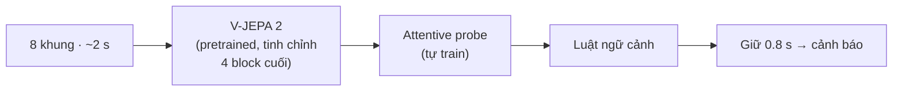
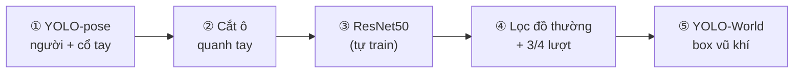

# Kịch bản trả lời khi bảo vệ: Phá hoại tài sản & Người cầm vật sắc nhọn

Tài liệu đi kèm: [bao-ve-pha-hoai-va-vat-sac-nhon.md](bao-ve-pha-hoai-va-vat-sac-nhon.md) (sơ đồ pipeline và số liệu chi tiết).

Khung trả lời cho mỗi nhánh: **mục tiêu → các bước xử lý → ra quyết định thế nào → chống báo nhầm → kết quả**.

---

## 1. Câu hỏi chính: "Hai hướng này em thực hiện logic như thế nào?"

### Mở đầu (~10 giây)

> "Hai hành vi này em làm thành hai nhánh chạy song song với bốn nhánh đánh, vật, ngã, chạy có sẵn. Chúng chạy trong một
> tiến trình riêng, để nhánh mới có lỗi thì hệ thống gốc vẫn hoạt động. Mỗi nhánh có một model em tự huấn luyện để ra quyết
> định, các model có sẵn khác chỉ làm tiền xử lý hoặc hậu xử lý."

### Nhánh phá hoại tài sản (~1 phút)

> "Phá hoại là hành động diễn ra theo thời gian, như đập, đá, xô đổ đồ, nên một ảnh đơn không đủ để nhận ra. Em lấy 8 khung
> hình gần nhất, khoảng 2 giây video, đưa qua V-JEPA 2. Đây là model video pretrained của Meta, đã học sẵn cách vật thể
> chuyển động và va chạm.
>
> Trên đặc trưng đó, em tự huấn luyện một attentive probe để chấm xác suất có phá hoại, và tinh chỉnh thêm 4 block cuối của
> backbone. Dữ liệu train là Kinetics, ASHEN và Charades. Video chỉ có nhãn cho cả video, nên em dùng học yếu: chia thành
> nhiều cửa sổ, điểm của video là trung bình 3 cửa sổ cao nhất.
>
> Để tránh báo nhầm, em thêm các luật ngữ cảnh: người đứng yên thì không tính; nếu đang có đánh nhau thì phải có điểm rất cao
> mới tính là phá hoại. Ngưỡng 0.667 được chọn sao cho precision đạt ít nhất 0.9. Cuối cùng phải giữ điểm cao 0.8 giây
> thì mới bật cảnh báo.
>
> Kết quả: báo nhầm 0% trên video sinh hoạt trong nhà (Charades), bắt đúng 94% video phá hoại thật của tập ASHEN."

### Nhánh người cầm vật sắc nhọn (~1 phút)

> "Vũ khí chỉ nguy hiểm khi đang được cầm, và con dao trong khung hình rất nhỏ. Vì vậy em không đi tìm vũ khí trên cả khung
> hình mà xử lý theo pipeline:
>
> **Một**, YOLO-pose tìm người và vị trí khuỷu tay, cổ tay.
> **Hai**, cắt một ô vuông quanh mỗi bàn tay, đẩy ra theo hướng cẳng tay để lấy được cả cán và lưỡi, rồi phóng to ô đó lên
> 224 pixel.
> **Ba**, đưa ô vào ResNet50 do em tự tinh chỉnh, để trả lời câu hỏi 'tay này có cầm vật sắc không'.
> **Bốn**, để chống báo nhầm, một YOLO COCO kiểm tra xem vật trong tay có phải chai, cốc hay điện thoại không; nếu đúng thì
> bỏ cảnh báo. Điểm cũng phải vượt ngưỡng ở 3 trong 4 lượt chấm gần nhất.
> **Năm**, khi đã cảnh báo, YOLO-World vẽ khung bao toàn bộ vũ khí để người xem thấy rõ.
>
> Dữ liệu train không cần vẽ box cho tay: nhãn của từng ô được suy ra tự động từ box vũ khí đã có trong dataset. Em cải tiến
> qua 4 phiên bản. Mỗi phiên bản sửa một lỗi gặp khi test thật, bằng cách thêm bản âm khó như cầm gậy, cầm điện thoại,
> cầm chổi.
>
> Kết quả: cảnh báo 89% thời gian trên clip dao phóng lợn, báo nhầm 0.9% trên clip người cầm đồ vật trong nhà."

---

## 2. Phần nào tự huấn luyện, phần nào dùng sẵn

Mỗi nhánh có **một checkpoint tự huấn luyện, và checkpoint đó ra quyết định**. Bỏ checkpoint đó thì nhánh không phát hiện
được gì. Bỏ các model phụ trợ thì nhánh vẫn phát hiện được, chỉ kém hơn.

| Nhánh | Thành phần | Nguồn | Tự huấn luyện? | Vai trò |
|---|---|---|---|---|
| Phá hoại | V-JEPA 2 ViT-L | Meta (pretrained) | Một phần: tinh chỉnh 4 block cuối (`vandalism_tail.pt`) | Trích đặc trưng chuyển động |
| | **Attentive probe** (`vandalism.pt`) | — | **Có, từ đầu** | **Ra quyết định** |
| Vật sắc nhọn | YOLO11s-pose | Ultralytics (pretrained) | Không | Tìm người, bàn tay (tiền xử lý) |
| | **ResNet50** (`hand_classifier.pt`) | Khởi tạo ImageNet | **Có**, 4 vòng hand_01 → hand_04 | **Ra quyết định** |
| | YOLO11s COCO | Ultralytics (pretrained) | Không | Lọc đồ vật thường (hậu xử lý) |
| | YOLO-World | Ultralytics (pretrained) | Không | Vẽ box vũ khí (chỉ để hiển thị) |

Câu nói gọn:

> "Mỗi hành vi có một checkpoint do nhóm tự huấn luyện để ra quyết định: attentive probe trên V-JEPA 2 cho phá hoại, và
> ResNet50 phân loại vùng quanh bàn tay cho cầm vật sắc nhọn. Các model pretrained khác (YOLO-pose, YOLO COCO, YOLO-World)
> đóng vai trò tiền xử lý và hậu xử lý trong pipeline, không được huấn luyện lại. Đây là học chuyển giao, cách làm chuẩn khi
> dữ liệu và GPU có hạn, tương tự hệ nhận diện khuôn mặt dùng model phát hiện mặt có sẵn rồi tự train phần nhận dạng."

Phần việc chính em đã làm:

1. **Đặt bài toán**: chọn cách "cắt ô quanh tay rồi phân loại" thay vì phát hiện vũ khí trên cả khung hình, có lý do và có số đo chứng minh.
2. **Dữ liệu**: thu thập dữ liệu VN (dao phóng lợn, mã tấu), tự quay 22 khung ở tư thế khó, **tự gán nhãn ô quanh tay từ box
   vũ khí**, chọn bản âm khó (gậy, điện thoại, chổi; COCO, Charades), chia tập theo nguồn để tránh lộ dữ liệu.
3. **Huấn luyện hai checkpoint**: vandalism probe cùng phần tinh chỉnh; hand classifier qua 4 vòng, mỗi vòng sửa một lỗi gặp khi test thật.
4. **Hiệu chỉnh và đánh giá**: chọn ngưỡng theo quy tắc (precision ≥ 0.9; báo nhầm ≤ 3%), đo trên tập test và trên clip theo thời gian.
5. **Tích hợp**: tiến trình riêng để cách ly, cổng xác nhận theo thời gian, luật 3/4, xử lý chập chờn và giật hình.

---

## 3. Câu hỏi phụ có thể gặp

| Câu hỏi | Ý trả lời |
|---|---|
| **Sao không dùng YOLO phát hiện vũ khí trực tiếp?** | Đã thử (bản sharp_02). Dao chỉ chiếm vài chục pixel trên khung 1280×720 nên khó học, train lâu; lại không biết dao có đang được cầm hay không. Cắt ô quanh tay vừa phóng to được vật, vừa chỉ xét vật đang cầm |
| **Phần nào em tự làm, phần nào dùng sẵn?** | Xem mục 2. Tự train phần ra quyết định; dùng sẵn phần tiền xử lý / hậu xử lý |
| **Làm sao biết model không học vẹt?** | Chia tập theo nguồn, cùng một video không lọt vào cả train và test. Có tập test riêng, và đo thêm trên clip chưa dùng để train (24 clip Charades, video tự quay) |
| **Báo nhầm thì xử lý sao?** | Ba lớp: bản âm khó khi train; bộ lọc đồ vật thường; luật thời gian (3/4 lượt và cổng xác nhận). Mỗi lớp đều có số đo trước và sau |
| **Chọn ngưỡng thế nào?** | Không chỉnh tay. Phá hoại: ngưỡng thấp nhất đạt precision ≥ 0.9. Vật sắc nhọn: ngưỡng thấp nhất mà báo nhầm ≤ 3% trên ảnh không có vũ khí của tập val |
| **Có cách nào đã thử mà thất bại không?** | Có. Lọc "gậy hay dao" bằng YOLO-World chặn mất 30/40 cảnh báo dao phóng lợn thật (dao phóng lợn là cây sào có lưỡi), nên em bỏ. Nâng ngưỡng lên 0.997 thì điện thoại vẫn ≥ 0.95 và mất luôn cả dao thật |
| **Bộ lọc đồ vật có làm mất cảnh báo dao thật không?** | Có một chút: bỏ được 15/23 khung báo nhầm do bình nước, điện thoại, chỉ mất 5/229 khung dao phóng lợn; cả 16 clip dao vẫn được cảnh báo. Không bao giờ lọc dao, kéo, nĩa |
| **Sao phải chờ 3/4 lượt mới báo?** | Vật thường cho điểm nhảy lung tung (0.01 rồi 0.98); dao thật cho điểm cao ổn định. Đánh đổi: cảnh báo chậm hơn khoảng 0.5 giây |
| **Hạn chế còn lại?** | Rìu bắt kém (ít dữ liệu); cây lau nhà giơ cao đôi khi vẫn bị báo nhầm; người ở xa hoặc tay bị che thì không chấm được; nhánh phá hoại chưa biết chính xác ai là người phá; súng và gậy cùn ngoài phạm vi |
| **Chạy realtime được không?** | Được trên GPU laptop RTX 4050 6 GB. Nhánh vật sắc nhọn ~55 ms mỗi lượt, cập nhật mỗi 0.27 giây; nhánh phá hoại ~0.8 giây một lần; hệ thống gốc giữ nguyên nhịp 0.27 giây, không bỏ lượt nào |
| **Vì sao tách tiến trình riêng?** | Khác thư viện (V-JEPA 2 cần transformers 4.57, hệ thống gốc dùng 4.45); nhánh mới lỗi hoặc hết bộ nhớ GPU thì chỉ worker đó dừng. Bộ test cách ly: 68 đạt |
| **Vì sao dùng V-JEPA 2 cho phá hoại?** | Model video học tự giám sát trên lượng lớn video, nắm được chuyển động và va chạm; chỉ cần train probe nhỏ trên đó nên ít dữ liệu vẫn đạt AP 0.898 trên dev |
| **Gán nhãn dữ liệu cho tay thế nào?** | Tự động: chạy pose trên ảnh có box vũ khí; ô quanh tay chạm ≥ 25% box vũ khí là dương, không chạm là âm, lưng chừng thì bỏ |

---

## 4. Số liệu nên nhớ

| Nhánh | Con số |
|---|---|
| Phá hoại | Dev AP **0.898**, AUC 0.978 · Test AUC **0.959** · ASHEN recall **0.94** · Charades báo nhầm **0%** · ngưỡng 0.667 (precision ≥ 0.9) |
| Vật sắc nhọn (hand_04) | Clip dao phóng lợn: cảnh báo **89%** thời gian · Charades cầm đồ: báo nhầm **0.9%** · video cầm gậy: **35% → 3%** qua các phiên bản · bộ lọc: **−15/23** báo nhầm, mất **5/229** khung dao |
| Hiệu năng | ~55 ms/lượt · cập nhật **0.27 s** · 0 lượt bị bỏ trên video 180 s |

---

## 5. Mẹo khi trình bày

- Vừa nói vừa chỉ vào sơ đồ pipeline trong tài liệu chính, mỗi câu ứng với một ô.
- Khi bị hỏi sâu thì trả lời bằng **số đo cụ thể**, ví dụ "bỏ được 15/23 khung báo nhầm, chỉ mất 5/229 khung dao thật".
- Chủ động nêu hạn chế trước khi bị hỏi: cho thấy hiểu rõ hệ thống và có hướng tiếp.
- Khi demo, chọn chế độ **"Sáu hành vi: Đánh / Vật / Ngã / Chạy / Phá hoại / Cầm vật sắc"**.
