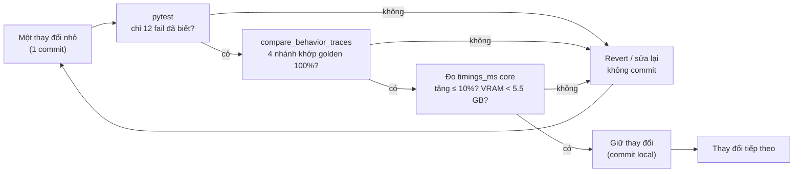
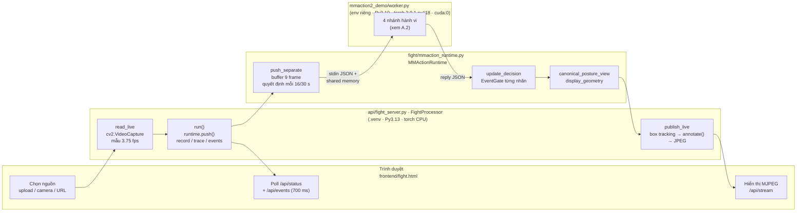
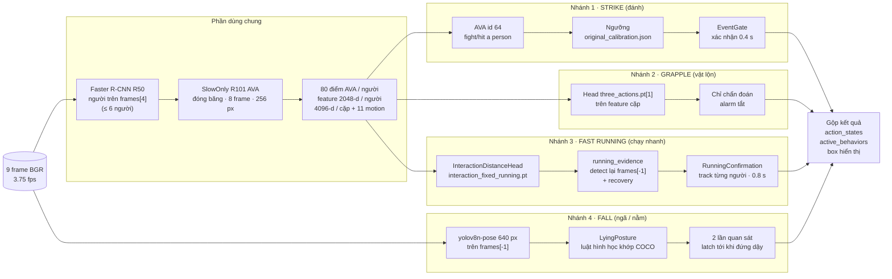
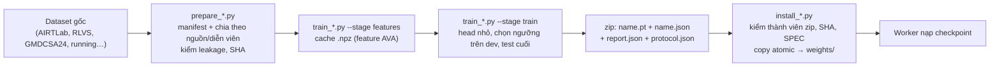
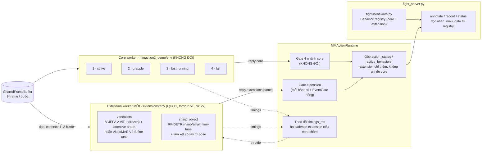
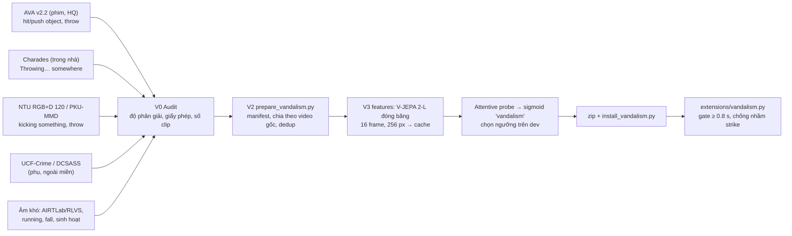
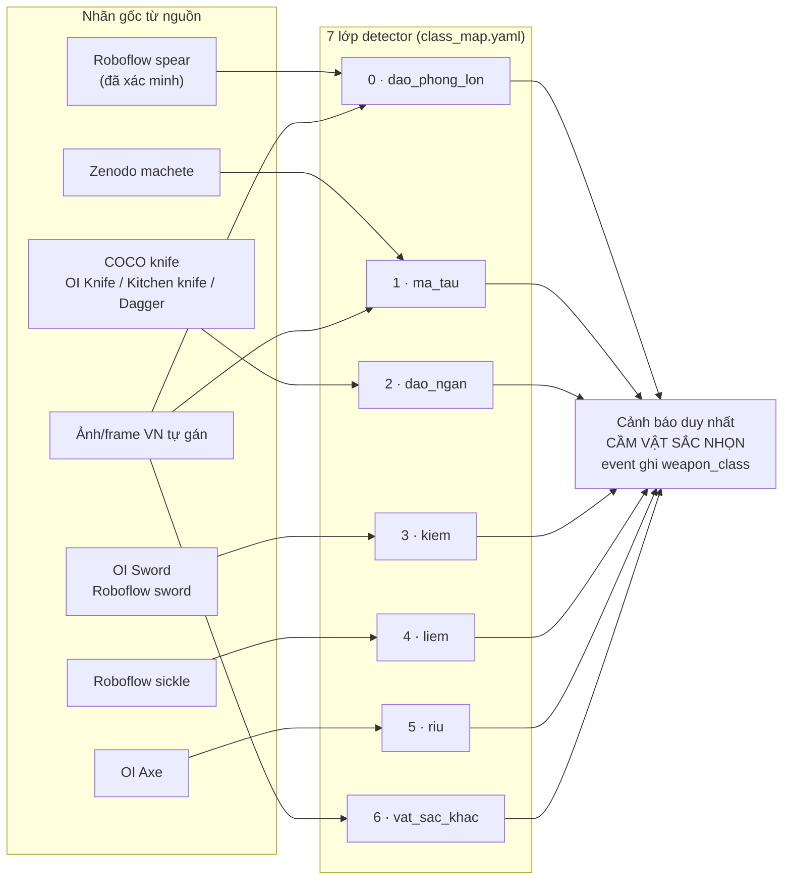
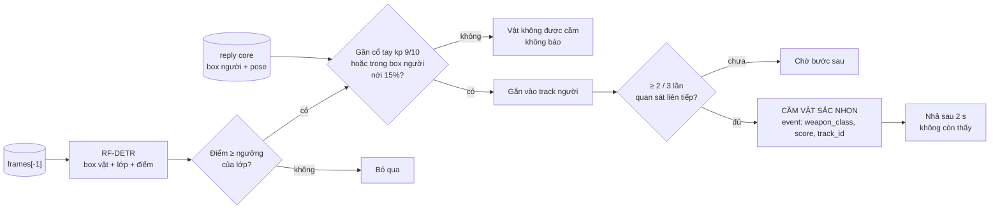

# Sơ đồ mermaid – Kế hoạch mở rộng
Dán từng khối vào https://mermaid.live (chỉ lấy phần bên trong ```mermaid … ```).

## Vòng kiểm tra sau mỗi thay đổi



## A.1 Luồng hệ thống tổng thể



## A.2 Kiến trúc 4 nhánh hành vi



## A.3 Huấn luyện hiện tại



## B.1 Kiến trúc đích (core + extension worker)



## E.1 Phá hoại tài sản: dữ liệu → train → tích hợp



## F.1 Cầm vật sắc nhọn: 3 bước chính + tích hợp

```mermaid
flowchart LR
    subgraph B1["Bước 1 · Thu thập (S1)"]
        direction TB
        I1["Ảnh có nhãn sẵn<br/>Zenodo, Roboflow,<br/>COCO, Open Images"]
        V1["Video tin tức VN<br/>camera an ninh, phóng sự"]
        V2["Video quốc tế<br/>UCF-Crime Robbery/Assault"]
        EX["Trích frame 2 fps<br/>≤ 15 frame/clip, dedup pHash"]
        V1 --> EX
        V2 --> EX
    end

    subgraph B2["Bước 2 · Gán nhãn (S2–S3)"]
        direction TB
        PL["Gán sơ bộ<br/>SAM 3 / Grounding DINO<br/>prompt theo từng loại"]
        HL["Sửa tay trong CVAT<br/>track cho video<br/>thuộc tính held / occluded"]
        QA["QA 10% lần 2<br/>script kiểm lỗi box"]
        SP["Chia train/dev/test<br/>theo vụ việc / clip<br/>giữ clip test nguyên vẹn"]
        PL --> HL --> QA --> SP
    end

    subgraph B3["Bước 3 · Train (S4)"]
        direction TB
        TR["RF-DETR nhiều lớp<br/>Colab Pro"]
        BL["Baseline YOLO26-s<br/>cùng dữ liệu"]
        EV["mAP từng lớp<br/>+ đánh giá theo sự kiện"]
        TR --> EV
        BL --> EV
    end

    subgraph B4["Tích hợp + kiểm thử (S5–S6)"]
        direction TB
        INS["install_sharp_object.py"]
        EXT["extensions/sharp_object.py<br/>liên kết cổ tay + gate"]
        AL["Cảnh báo chung<br/>CẦM VẬT SẮC NHỌN"]
        INS --> EXT --> AL
    end

    I1 --> PL
    EX --> PL
    SP --> TR
    SP --> BL
    EV --> INS
```



## F.2 Nhãn gốc → 7 lớp → 1 cảnh báo



## F.3 Logic cảnh báo vật sắc nhọn lúc chạy



## I.1 Lộ trình thực hiện cả 2 hướng (chiều ngang)

```mermaid
flowchart LR
    START(["Bắt đầu<br/>(local)"]) --> G0
    START --> S0

    subgraph P0["Giai đoạn 0 · Kiến trúc (local)"]
        direction LR
        G0["0.1 Golden<br/>baseline"] --> G1["0.2 Registry"] --> G2["0.3 Extension<br/>worker + env"] --> G3["0.4 Backend<br/>_ext"] --> G4["0.5 Test cô lập<br/>VRAM"] --> G5["0.6 Tài liệu"]
    end

    G5 --> M0{{"M0<br/>core khớp<br/>golden 100%"}}

    subgraph PV["Hướng 1 · Phá hoại tài sản"]
        direction LR
        V0["V0 Audit<br/>dữ liệu"] --> V1["V1 Baseline<br/>AVA"] --> V2["V2 prepare"] --> V3["V3 Train<br/>Colab Pro"] --> V4["V4 Đóng gói<br/>install"] --> V5["V5 Tích hợp<br/>_ext"] --> V6["V6 Kiểm thử"]
    end

    subgraph PSD["Hướng 2 · Dữ liệu vật sắc nhọn (song song, không đụng code)"]
        direction LR
        S0["S0 Taxonomy<br/>giấy phép"] --> S1["S1 Thu thập<br/>video ≥ 20%"] --> S2["S2 Gán nhãn<br/>từng loại + QA"] --> S3["S3 Đóng gói<br/>dataset"]
    end

    subgraph PST["Hướng 2 · Train + tích hợp"]
        direction LR
        S4["S4 Train RF-DETR<br/>Colab Pro"] --> S5["S5 Install +<br/>extension"] --> S6["S6 Kiểm thử"]
    end

    M0 --> V0
    V6 --> M1{{"M1<br/>VANDALISM<br/>ổn trong _ext"}}
    S3 --> S4
    M1 --> S5
    S6 --> M2{{"M2<br/>SHARP OBJECT<br/>ổn trong _ext"}}

    subgraph PZ["Tổng kiểm"]
        direction LR
        Z1["Z1 Chạy cả 2<br/>extension"] --> Z2["Z2 Hồi quy<br/>toàn bộ"] --> Z3["Z3 Kịch bản<br/>demo"] --> Z4["Z4 Duyệt, đổi<br/>backend mặc định"]
    end

    M2 --> Z1
    Z4 --> DONE(["Push GitHub<br/>1 lần"])

    classDef colab stroke:#d97706,stroke-width:3px
    classDef gate stroke:#16a34a,stroke-width:3px
    class V3,S4 colab
    class M0,M1,M2 gate
```


